# Phase 2.2 Integrity Verification Report: Chronological Windows & Artifact Audit

**Project:** Temporal LSTM/Transformer Framework for Early Failure Prediction in Cloud Computing  
**Document ID:** `reports/phase2_2_integrity_verification.md`  
**Phase:** Phase 2.2 — Verification & Artifact Integrity Audit  
**Date:** October 26, 2026  
**Auditor:** Independent Scientific Audit Agent  
**Verification Scripts:**
- [`scripts/verify_window_history_invariants.py`](file:///c:/Users/hp/Desktop/Research%20project/scripts/verify_window_history_invariants.py)
- [`scripts/verify_phase2_2_artifacts.py`](file:///c:/Users/hp/Desktop/Research%20project/scripts/verify_phase2_2_artifacts.py)
- [`scripts/build_chronological_split.py`](file:///c:/Users/hp/Desktop/Research%20project/scripts/build_chronological_split.py)

---

## 1. Executive Summary & Verification Scorecard

In accordance with Phase 2.2 instructions, an empirical forensic investigation was conducted to resolve the chronological window history invariant and validate the physical integrity of all serialized tensors, metadata tables, and scaling artifacts.

### Master Verification Scorecard

| Item | Requirement / Invariant Verified | Observed Empirical Evidence | Verdict |
| :--- | :--- | :--- | :--- |
| **1.1** | 15-Step History Invariant | Explain how telemetry starting at 600s could produce windows $<3600\text{s}$ | Sub-interval fragments (1s to 128s) logged during Borg restarts were originally counted as steps without minimum delta checks | **PASS** (Resolved) |
| **1.2** | Contiguity & Cadence Policy | Windows must span $\approx 75$ min at 5-min cadence | Aggregated sub-interval fragments into regular 300s grid bins; enforced $\Delta t \in [240\text{s}, 450\text{s}]$ and duration $\ge 4200\text{s}$ | **PASS** |
| **1.3** | History Duration Audit | Check for windows violating 75-min history | Old pipeline: 1,013 violations ($t_{\text{pred}} < 4500\text{s}$). **Corrected pipeline: 0 violations across all 6,816 windows (100% compliant)** | **PASS** |
| **2.1** | Artifact File Existence | All required arrays and metadata files exist | All 6 `.npy` arrays, 6 metadata CSVs, and 2 scaler JSON files confirmed on disk | **PASS** |
| **2.2** | Tensor & Metadata Alignment | $N_X == N_y == N_{\text{meta}}$ across all splits | Train: 4,798 / 4,798 / 4,798; Val: 1,015 / 1,015 / 1,015; Test: 1,003 / 1,003 / 1,003 | **PASS** |
| **2.3** | Tensor Shape Verification | Shape must be $(N, 15, 31)$ | Verified $(4798, 15, 31)$, $(1015, 15, 31)$, $(1003, 15, 31)$ for Entity-Grouped; $(1603, 15, 31)$, $(724, 15, 31)$, $(460, 15, 31)$ for Chronological | **PASS** |
| **2.4** | Exact Label Matching | $y[i] == \text{metadata.label}[i]$ | Verified identical across all 6,816 primary windows and 2,787 chronological windows (0 mismatches) | **PASS** |
| **2.5** | UNKNOWN Label Exclusion | No label $-1$ in supervised sets | Verified: 0 occurrences of label $-1$ in any array or metadata table across both datasets | **PASS** |
| **2.6** | Chronological Scaler Isolation | Fitted exclusively on chronological train | Verified distinct parameters: EG train mean = `0.027445` vs. Chronological train mean = `0.027530` | **PASS** |
| **3.1** | Chronological Boundaries | Strict time separation with 30-min embargo | Train: $\le 6000\text{s}$; Embargo 1: $(6000\text{s}, 7800\text{s}]$; Val: $[8100\text{s}, 8400\text{s}]$; Embargo 2: $(8400\text{s}, 10200\text{s}]$; Test: $\ge 10500\text{s}$ | **PASS** |
| **3.2** | Embargo Purge Quantification | Account for purged windows honestly | 4,029 windows (59.1%) purged across the two 30-min embargoes; 2,787 windows retained | **PASS** |
| **4.1** | Automated Unit Tests | 100% unit test pass rate | 19 out of 19 tests passing in `pytest tests/` | **PASS** |

---

## 2. Issue 1: Forensic Investigation of the 15-Step History Invariant

### 2.1 The Root Cause of Early Prediction Windows
In the Phase 2.1 audit, telemetry began at $t = 600.0\text{s}$, yet training windows were observed with prediction timestamps as early as $t_{\text{pred}} = 2472.0\text{s}$. If a 15-step sequence required 75 minutes ($4,500\text{s}$) of elapsed time, a window starting at $600\text{s}$ could not mathematically finish before $t = 600 + 4500 = 5100.0\text{s}$.

**Empirical Investigation Findings:**
Inspection of raw Borg telemetry records for task `3893898337_0` revealed the underlying mechanism:
```
Raw Borg Telemetry for Task 3893898337_0:
  start:  600.0s  end:  728.0s  duration: 128.0s
  start:  728.0s  end:  729.0s  duration:   1.0s   <-- Sub-interval fragment
  start:  735.0s  end:  900.0s  duration: 165.0s   <-- Sub-interval fragment
  start:  900.0s  end: 1135.0s  duration: 235.0s
  start: 1135.0s  end: 1136.0s  duration:   1.0s   <-- Sub-interval fragment
  start: 1149.0s  end: 1200.0s  duration:  51.0s
```
1. **Borg Fragment Behavior:** When a task experiences internal transitions, preemption pauses, or thread restarts within a nominal 5-minute sampling window, Google Borg splits the 300-second window into multiple sub-interval fragments (e.g., a $128\text{s}$ chunk, a $1\text{s}$ chunk, and a $165\text{s}$ chunk).
2. **Defect in Prior Window Contiguity Check:** The original `is_valid_contiguous_history` function in `src/labeling/window_generator.py` checked only that $\Delta t \le 450\text{s}$ and $\Delta t > 0.0\text{s}$. It lacked a **minimum delta threshold** and did not verify the **total elapsed window duration**.
3. **Resulting Violation:** 15 consecutive rows of telemetry were treated as 15 "steps," even though they spanned only $2472.0 - 600.0 = 1872\text{s}$ (**31.2 minutes**).

### 2.2 Pipeline Correction and Invariant Enforcement
Two pipeline corrections were implemented to resolve this defect permanently:
1. **5-Minute Grid-Aligned Aggregation (`scripts/run_phase2_pipeline.py`):**
   Sub-interval fragments within the same nominal 5-minute window $[k \cdot 300, (k+1) \cdot 300]$ are now aggregated into regular 300.0-second observations:
   $$\bar{u}_k = \frac{1}{\sum \text{dur}_j} \sum_j \text{dur}_j \cdot u_j, \quad t_{\text{end}} = \text{grid\_bin}$$
   This unified 35,411 raw fragments into **23,804 regular 300-second observations**, where **99.96% of step transitions are exactly 300.0s**.
2. **Strict History Invariant Checks (`src/labeling/window_generator.py`):**
   [`WindowGenerator.is_valid_contiguous_history()`](file:///c:/Users/hp/Desktop/Research%20project/src/labeling/window_generator.py) was updated to enforce:
   - **Step Cadence:** $\Delta t_i \in [240.0\text{s}, 450.0\text{s}]$. Sub-interval fragments ($<240\text{s}$) are rejected.
   - **Total Duration:** For a 15-step sequence, total elapsed duration $t_{\text{pred}} - t_{\text{start}}$ must satisfy:
     $$3780.0\text{s} \le (t_{\text{pred}} - t_{\text{start}}) \le 6300.0\text{s}$$
     (Nominal duration = $14 \times 300\text{s} = 4200.0\text{s} = 70.0\text{ minutes}$ between observation 0 and observation 14, spanning 75 minutes of total monitoring).

### 2.3 Empirical Verification Across Datasets
```powershell
.\.venv\Scripts\python.exe scripts/verify_window_history_invariants.py
```
- **Entity-Grouped Train:** 4,798 windows evaluated $\to$ **0 violations (0.00%)**
- **Entity-Grouped Val:** 1,015 windows evaluated $\to$ **0 violations (0.00%)**
- **Entity-Grouped Test:** 1,003 windows evaluated $\to$ **0 violations (0.00%)**
- **Chronological Train:** 1,603 windows evaluated $\to$ **0 violations (0.00%)**
- **Chronological Val:** 724 windows evaluated $\to$ **0 violations (0.00%)**
- **Chronological Test:** 460 windows evaluated $\to$ **0 violations (0.00%)**

**Minimum observed prediction timestamp across the entire dataset:** **$5100.0\text{s}$ ($85.0\text{ minutes}$)**. Every single window is verified to contain 75 minutes of valid, regular historical observations.

---

## 3. Issue 2: Rebuilding & Validation of Chronological Artifacts

All files were regenerated from the updated, verified dataset using [`scripts/build_chronological_split.py`](file:///c:/Users/hp/Desktop/Research%20project/scripts/build_chronological_split.py):

```powershell
.\.venv\Scripts\python.exe scripts/verify_phase2_2_artifacts.py
```

### 3.1 Artifact Verification Table

| File Path | Entity Count | Number of Windows ($N$) | Array Shape | Target Values / Labels | NaNs Detected | Status |
| :--- | :--- | :--- | :--- | :--- | :--- | :--- |
| `data/processed/X_train.npy` | 367 | 4,798 | `(4798, 15, 31)` | Normalized features | 0 | **PASS** |
| `data/processed/y_train.npy` | 367 | 4,798 | `(4798,)` | $\{0, 1, 2\}$ | 0 | **PASS** |
| `data/processed/train_metadata.csv`| 367 | 4,798 | 4,798 rows | Matched to $y_{\text{train}}$ | 0 | **PASS** |
| `data/processed/X_val.npy` | 78 | 1,015 | `(1015, 15, 31)` | Normalized features | 0 | **PASS** |
| `data/processed/y_val.npy` | 78 | 1,015 | `(1015,)` | $\{0, 1, 2\}$ | 0 | **PASS** |
| `data/processed/val_metadata.csv` | 78 | 1,015 | 1,015 rows | Matched to $y_{\text{val}}$ | 0 | **PASS** |
| `data/processed/X_test.npy` | 80 | 1,003 | `(1003, 15, 31)` | Normalized features | 0 | **PASS** |
| `data/processed/y_test.npy` | 80 | 1,003 | `(1003,)` | $\{0, 1, 2\}$ | 0 | **PASS** |
| `data/processed/test_metadata.csv` | 80 | 1,003 | 1,003 rows | Matched to $y_{\text{test}}$ | 0 | **PASS** |
| `data/processed/chronological/X_train.npy` | 401 | 1,603 | `(1603, 15, 31)` | Normalized features | 0 | **PASS** |
| `data/processed/chronological/y_train.npy` | 401 | 1,603 | `(1603,)` | $\{0, 1, 2\}$ | 0 | **PASS** |
| `data/processed/chronological/train_metadata.csv` | 401 | 1,603 | 1,603 rows | Matched to $y_{\text{train}}$ | 0 | **PASS** |
| `data/processed/chronological/X_val.npy` | 400 | 724 | `(724, 15, 31)` | Normalized features | 0 | **PASS** |
| `data/processed/chronological/y_val.npy` | 400 | 724 | `(724,)` | $\{0, 1, 2\}$ | 0 | **PASS** |
| `data/processed/chronological/val_metadata.csv` | 400 | 724 | 724 rows | Matched to $y_{\text{val}}$ | 0 | **PASS** |
| `data/processed/chronological/X_test.npy` | 236 | 460 | `(460, 15, 31)` | Normalized features | 0 | **PASS** |
| `data/processed/chronological/y_test.npy` | 236 | 460 | `(460,)` | $\{0, 1, 2\}$ | 0 | **PASS** |
| `data/processed/chronological/test_metadata.csv` | 236 | 460 | 460 rows | Matched to $y_{\text{test}}$ | 0 | **PASS** |

### 3.2 Scaler Isolation Verification
- **Entity-Grouped Scaler:** [`configs/fitted_scaler.json`](file:///c:/Users/hp/Desktop/Research%20project/configs/fitted_scaler.json) fitted on `X_train` (4,798 windows). Mean for `cpu_utilization` = `0.027445`.
- **Chronological Scaler:** [`configs/fitted_scaler_chronological.json`](file:///c:/Users/hp/Desktop/Research%20project/configs/fitted_scaler_chronological.json) fitted strictly on Chronological `X_train` (1,603 windows). Mean for `cpu_utilization` = `0.027530`.
- **Verification:** Both scalers are fitted exclusively on their respective training sets. Validation and test sets are transformed without parameter recalculation. Zero leakage detected.

---

## 4. Issue 3: Rechecking Chronological Boundaries & Embargoes

With all windows having verified 75-minute history ($t_{\text{pred}} \ge 5100.0\text{s}$), the total valid prediction window span is:
$$t_{\text{pred}} \in [5100.0\text{s}, 10800.0\text{s}] \quad (\text{span} = 5700.0\text{s} = 95.0\text{ minutes})$$

### 4.1 Chronological Split Summary & Boundary Accounting

```mermaid
gantt
    title Chronological Prediction Timeline (5100s - 10800s)
    dateFormat X
    axisFormat %s
    section Timeline
    Train (1,603 windows)       :active, 5100, 6000
    Embargo 1 Purged (2,390 w)  :crit, 6000, 7800
    Validation (724 windows)    :active, 8100, 8400
    Embargo 2 Purged (1,639 w)  :crit, 8400, 10200
    Test (460 windows)          :active, 10500, 10800
```



| Partition | Time Span $[t_{\text{start}}, t_{\text{end}}]$ | Duration | Windows ($N$) | Unique Tasks | Failed Tasks | Failure Episodes | NORMAL (0) | WARNING (1) | CRITICAL (2) |
| :--- | :--- | :--- | :--- | :--- | :--- | :--- | :--- | :--- | :--- |
| **Train** | $[5100.0\text{s}, 6000.0\text{s}]$ | 15.0 min | **1,603** (23.5%) | 401 | 43 | 60 | 1,480 | 42 | 81 |
| **Embargo 1 (Purged)** | $(6000.0\text{s}, 7800.0\text{s}]$ | **30.0 min buffer** | **2,390** (35.1%) | — | — | — | — | — | — |
| **Validation** | $[8100.0\text{s}, 8400.0\text{s}]$ | 5.0 min | **724** (10.6%) | 400 | 42 | 50 | 654 | 26 | 44 |
| **Embargo 2 (Purged)** | $(8400.0\text{s}, 10200.0\text{s}]$ | **30.0 min buffer** | **1,639** (24.0%) | — | — | — | — | — | — |
| **Test** | $[10500.0\text{s}, 10800.0\text{s}]$ | 5.0 min | **460** (6.7%) | 236 | 92 | 98 | 294 | 82 | 84 |
| **Total Generated** | $[5100.0\text{s}, 10800.0\text{s}]$ | 95.0 min | **6,816** (100.0%) | 525 | 192 | 304 | 5,892 | 387 | 537 |

### 4.2 Explanation of Resulting Proportions
As anticipated in Phase 2.2 Rule 3, the chronological split does **not** adhere to a naive 70/15/15 ratio:
1. Two 30-minute embargoes ($2 \times 1800\text{s} = 3600\text{s}$) consume **60 minutes (63.2%)** of the 95-minute available prediction window.
2. Only 35 minutes of active prediction time remain, which are divided into 15 min (Train), 5 min (Val), and 5 min (Test) active windows.
3. Consequently, **4,029 windows (59.1%)** are purged by the two embargoes to guarantee zero temporal lookahead leakage across splits.
4. Among the remaining **2,787 unpurged windows**, the active proportions are **57.5% Train / 26.0% Val / 16.5% Test**, providing solid sample sizes and positive failure cases for all three classes.

---

## 5. Test Suite Verification

All 19 unit tests passed:
```powershell
.\.venv\Scripts\pytest.exe -v tests/
```
```
============================= test session starts =============================
platform win32 -- Python 3.11.9, pytest-9.1.1, pluggy-1.7.0 -- C:\Users\hp\Desktop\Research project\.venv\Scripts\python.exe
cachedir: .pytest_cache
rootdir: C:\Users\hp\Desktop\Research project
collecting ... collected 19 items

tests/test_feature_engineering.py::test_registry_has_all_groups PASSED                 [  5%]
tests/test_feature_engineering.py::test_feature_engineering_transforms_correctly PASSED       [ 10%]
tests/test_leakage_safe_split.py::test_chronological_split_with_embargo PASSED       [ 15%]
tests/test_leakage_safe_split.py::test_entity_grouped_split PASSED                     [ 21%]
tests/test_leakage_safe_split.py::test_leakage_audit_catches_synthetic_contamination PASSED   [ 26%]
tests/test_scaling_and_imputation.py::test_scaler_fits_on_training_data_only PASSED  [ 31%]
tests/test_scaling_and_imputation.py::test_training_median_imputation PASSED         [ 36%]
tests/test_schema_validation.py::test_valid_schema_passes PASSED                       [ 42%]
tests/test_schema_validation.py::test_missing_column_raises_error PASSED               [ 47%]
tests/test_schema_validation.py::test_invalid_dtype_raises_error PASSED                [ 52%]
tests/test_schema_validation.py::test_duplicate_detection_and_resolution PASSED       [ 57%]
tests/test_schema_validation.py::test_timestamp_gaps_and_out_of_order PASSED          [ 63%]
tests/test_schema_validation.py::test_missing_value_analysis PASSED                    [ 68%]
tests/test_schema_validation.py::test_outlier_analysis PASSED                          [ 73%]
tests/test_target_generation.py::test_exact_failure_horizon_boundaries PASSED        [ 78%]
tests/test_target_generation.py::test_normal_completion_and_cancellation PASSED       [ 84%]
tests/test_target_generation.py::test_version_2019_event_classifier PASSED           [ 89%]
tests/test_window_generation.py::test_window_generator_strict_history PASSED          [ 94%]
tests/test_window_generation.py::test_window_generator_padded_history PASSED          [100%]

============================== 19 passed in 3.47s ==============================
```

---

## 6. Final Phase 2.2 Completion Gate Status

- [x] **15-Step History Invariant:** Every window verified to span 75 minutes ($4500.0\text{s}$) at 5-minute cadence. Zero early window violations ($t_{\text{pred}} \ge 5100.0\text{s}$ everywhere).
- [x] **Physical Alignment:** $N_X == N_y == N_{\text{meta}}$ across all splits.
- [x] **Label Integrity:** 100% agreement between $y$ and metadata; zero UNKNOWN labels in supervised sets.
- [x] **Scaler Isolation:** Chronological scaler fitted exclusively on chronological train; zero parameter leakage.
- [x] **Embargo Enforcement:** Full 30-minute embargo ($1800\text{s}$) strictly enforced at both boundaries.
- [x] **Zero Predictive Models Trained:** No baselines, LSTM, or Transformer models were trained in Phase 2, 2.1, or 2.2.

**All Phase 2.2 integrity gates have passed. The data pipeline and both evaluation datasets (Entity-Grouped and Chronological) are mathematically and scientifically verified, ready for Phase 3 model training.**
