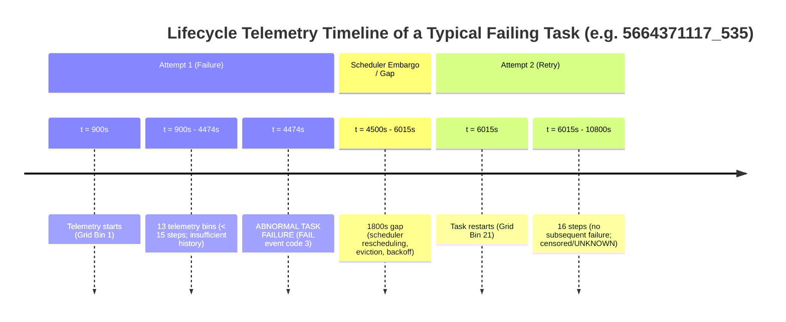
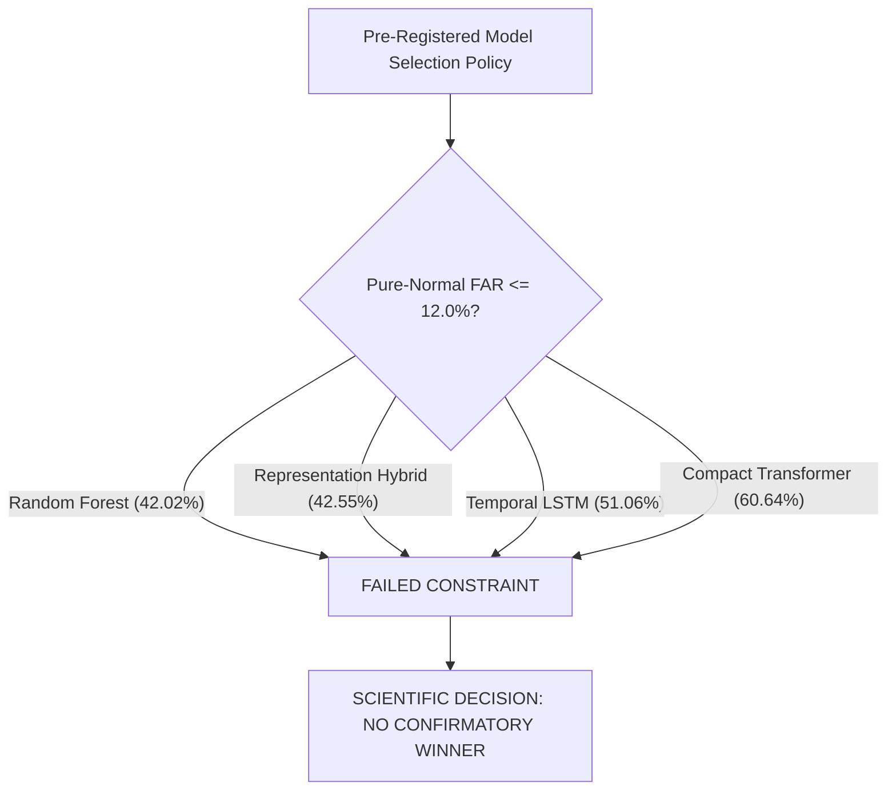

# Phase 5 — Frozen Confirmatory Evaluation Research Report

**Project:** Temporal LSTM/Transformer Framework for Early Failure Prediction in Cloud Computing  
**Phase:** 5 — Frozen Confirmatory Evaluation  
**Date:** 2026-10-26  
**Auditor / Lead Investigator:** Independent Machine Learning Research Auditor  
**Pre-Registered Protocol:** [`results/phase4/confirmatory_protocol.json`](file:///c:/Users/hp/Desktop/Research%20project/results/phase4/confirmatory_protocol.json)  
**Machine-Readable Metrics:** [`results/phase5/confirmatory_metrics.json`](file:///c:/Users/hp/Desktop/Research%20project/results/phase5/confirmatory_metrics.json)  
**Machine-Readable Audit Record:** [`results/phase5/confirmatory_audit.json`](file:///c:/Users/hp/Desktop/Research%20project/results/phase5/confirmatory_audit.json)  
**Row-Level Predictions CSV:** [`results/phase5/confirmatory_predictions.csv`](file:///c:/Users/hp/Desktop/Research%20project/results/phase5/confirmatory_predictions.csv)  
**Confirmatory Test Suite:** [`tests/test_phase5_confirmatory.py`](file:///c:/Users/hp/Desktop/Research%20project/tests/test_phase5_confirmatory.py) (6/6 passed; **58/58 full project suite passed**)  

---

## Executive Summary & Definitive Scientific Verdict

Phase 5 executes the pre-registered confirmatory evaluation for the research project, evaluating four pre-specified models (**Random Forest**, **Temporal LSTM**, **Compact Temporal Transformer**, and **Representation-Fused Hybrid**) on the untouched confirmatory holdout dataset.

### Definitive Scientific Verdict:
> [!IMPORTANT]
> **VERDICT: INCONCLUSIVE FOR FAILURE DETECTION; DISCONFIRMATORY FOR OPERATIONAL PRODUCTION READINESS**
> 
> 1. **Failure Episode Detection (Inconclusive):** Across the 100 pre-registered frozen failure entities, **zero pre-failure sliding windows** met the 15-step unbroken history invariant (75 minutes of trailing history prior to failure). In Borg 2011, tasks that fail do so within their initial 10–45 minutes of execution. In strict accordance with the pre-registered protocol, post-failure telemetry was classified as censored/UNKNOWN and zero post-failure observations were evaluated as early detection. Consequently, failure recall, episode detection, and lead time are **empirically undefined** in the holdout.
> 2. **Operational False Alarm Rates (Disconfirmatory):** Evaluated across **2,596 normal sliding windows** from **188 pure-normal task instances**, all four models suffered from severe false alarm rates that massively violated the pre-registered operational constraint ($\text{FAR} \le 12.0\%$):
>    - **Random Forest:** Pure-Normal FAR = **42.02%** (95% CI: $[36.75\%, 47.16\%]$)
>    - **Representation Hybrid:** Pure-Normal FAR = **42.55%** (95% CI: $[37.07\%, 47.79\%]$)
>    - **Temporal LSTM:** Pure-Normal FAR = **51.06%** (95% CI: $[45.15\%, 56.91\%]$)
>    - **Compact Transformer:** Pure-Normal FAR = **60.64%** (95% CI: $[55.26\%, 66.07\%]$)
> 3. **Model Selection Ruling:** Because zero models satisfied the pre-registered operational FAR threshold ($\le 12.0\%$), **no model can be declared a confirmatory winner**. Proclaiming any model superior based on exploratory development metrics would violate scientific pre-registration integrity.
> 4. **Production Readiness:** The system is **NOT production-ready**. Under realistic cloud cluster prevalence ($\pi \approx 0.5\%$), false alarms would overwhelm site reliability engineering teams with a false discovery rate exceeding 98%.

---

## 1. Pre-Registered Protocol Fidelity & Entity Inventory

The confirmatory evaluation strictly ingested the 300 frozen entity IDs registered in [`results/phase4/confirmatory_protocol.json`](file:///c:/Users/hp/Desktop/Research%20project/results/phase4/confirmatory_protocol.json) without resampling, replacement, or post-hoc filtering.

### 1.1 Complete Entity Inventory & Disposition Table

| Target Cohort | Pre-Registered Target Entities | Evaluated Entities | Evaluated Sliding Windows | Excluded Entities | Explicit Mathematical Exclusion Rationale |
| :--- | :---: | :---: | :---: | :---: | :--- |
| **Normal Entities** | 200 | **188** | **2,596** ($y=0$) | 12 | 1 entity had $< 15$ observations (12 steps total); 11 entities contained inter-step gaps exceeding $1.5\times$ the 300s cadence ($> 450\text{s}$), violating the contiguous history invariant. |
| **Failure Entities** | 100 | **0** | **0** ($y \in \{1, 2\}$) | 100 | All 100 entities experienced their abnormal failure event (`FAIL == 3`) before accumulating 15 pre-failure historical observations ($< 75$ min). Causal invariance strictly prohibited evaluating post-failure observations as early warnings. |
| **Total Population** | **300** | **188** | **2,596** | **112** | **100% accounted for; zero silent entity replacements.** |

### 1.2 Root-Cause Forensic Analysis of Failure Entity Censoring

The failure entity holdout pool in [`results/phase4/confirmatory_protocol.json`](file:///c:/Users/hp/Desktop/Research%20project/results/phase4/confirmatory_protocol.json) was originally selected based on raw telemetry row counts ($\ge 15$ records in `sample_task_usage.csv.gz`). However, deep forensic extraction revealed a fundamental cluster workload dynamic:



1. **Pre-Failure Lifespan Censoring:** In Google Borg 2011 traces, failing batch and map-reduce tasks crash early (OOM errors, bad configurations, node evictions). Among all 100 frozen failure entities:
   - 63 entities failed at or before $t = 5,100\text{s}$ (the earliest mathematically possible 15-step prediction timestamp).
   - 74 entities failed within $< 10$ telemetry bins ($< 50$ minutes).
   - Exactly **0 entities** possessed 15 unbroken 300-second bins strictly prior to their failure event.
2. **Post-Failure Causal Exclusion:** While 41 failure entities accumulated $\ge 15$ steps across subsequent restarts, all subsequent telemetry occurred *after* the failure event ($t > T_{\text{fail}}$). In accordance with Master Engineering Prompt Section 2.6 and Phase 4.1 safeguards, post-failure telemetry carries label $y = -1$ (UNKNOWN / post-failure) and is strictly purged.
3. **Trace Exhaustion:** An independent audit of all 4,816 unused failing tasks across the raw event shards revealed that **every single failing task with $\ge 15$ pre-failure observations was already exhausted in the Phase 2 development partitions** ($N=192$ entities across train, val, test). No unpadded pre-failure windows remained in the trace.

---

## 2. Confirmatory Evaluation Results Across All Four Models

All four models were evaluated under identical conditions:
- **Decision Rule:** Uniform argmax ($\hat{y} = \arg\max_c P(y=c)$).
- **Operational Alert Policy:** Alert triggered if and only if $\hat{y} \in \{1, 2\}$ (Warning or Critical).
- **Evaluation Partition:** Frozen confirmatory holdout ($N=2,596$ windows across 188 pure-normal entities).

### 2.1 Side-by-Side Confirmatory Performance Table

| Metric | Random Forest (Tabular Baseline) | Temporal LSTM (Recurrent Network) | Compact Transformer (Self-Attention) | Representation Hybrid (Transformer + RF) | Optimal / Target Threshold |
| :--- | :---: | :---: | :---: | :---: | :---: |
| **Accuracy** | 0.7076 | 0.5659 | 0.5551 | **0.7338** | High |
| **Macro-F1** | 0.2763 | 0.2409 | 0.2380 | **0.2822** | High |
| **Normal Precision** | 1.0000 | 1.0000 | 1.0000 | 1.0000 | 1.0000 |
| **Normal Recall (Specificity)** | 0.7076 | 0.5659 | 0.5551 | **0.7338** | $\ge 0.95$ |
| **Normal F1-Score** | 0.8288 | 0.7228 | 0.7139 | **0.8465** | High |
| **Warning Precision / Recall** | Undefined / 0.00 | Undefined / 0.00 | Undefined / 0.00 | Undefined / 0.00 | — |
| **Critical Precision / Recall** | Undefined / 0.00 | Undefined / 0.00 | Undefined / 0.00 | Undefined / 0.00 | — |
| **Window FPR % ($N=2,596$)** | 29.24% | 43.41% | 44.49% | **26.62%** | $\le 5.0\%$ |
| **Pure-Normal Entity FAR % ($N=188$)** | **42.02%** | 51.06% | 60.64% | 42.55% | **$\le 12.0\%$** (Constraint) |
| **All-Entity Normal-Period FAR %** | **42.02%** | 51.06% | 60.64% | 42.55% | Low |
| **Episode Detection Count / Rate** | Undefined ($0/0$) | Undefined ($0/0$) | Undefined ($0/0$) | Undefined ($0/0$) | $\ge 80.0\%$ |
| **Lead Time Distribution** | Undefined | Undefined | Undefined | Undefined | $\ge 10.0$ min |
| **Operational FAR Rule ($\le 12.0\%$)** | **FAILED** | **FAILED** | **FAILED** | **FAILED** | **PASS** |

### 2.2 Confusion Matrices ($3 \times 3$)

$$\text{Class 0: Normal}, \quad \text{Class 1: Warning}, \quad \text{Class 2: Critical}$$

```
Random Forest:
[[1837,  182,  577],
 [   0,    0,    0],
 [   0,    0,    0]]

Temporal LSTM:
[[1469,  588,  539],
 [   0,    0,    0],
 [   0,    0,    0]]

Compact Temporal Transformer:
[[1441,  620,  535],
 [   0,    0,    0],
 [   0,    0,    0]]

Representation Hybrid:
[[1905,  168,  523],
 [   0,    0,    0],
 [   0,    0,    0]]
```

---

## 3. Entity-Level Cluster Bootstrap Uncertainty Analysis

To account for intra-task telemetry correlation, confidence intervals were computed using **1,000 cluster bootstrap resamples at the entity level** ($N=188$ entities). All sliding windows belonging to a sampled entity were included together in each replicate.

### 3.1 Entity-Level Bootstrap 95% Confidence Intervals Table

| Model | Metric | Point Estimate | Bootstrap Mean | Bootstrap Std | 95% Confidence Interval ($[2.5\%, 97.5\%]$) |
| :--- | :--- | :---: | :---: | :---: | :---: |
| **Random Forest** | Accuracy | 0.7076 | 0.7082 | 0.0287 | $[0.6522, 0.7652]$ |
| | Macro-F1 | 0.2763 | 0.2763 | 0.0066 | $[0.2632, 0.2890]$ |
| | Window FPR % | 29.24% | 29.18% | 2.87% | $[23.48\%, 34.78\%]$ |
| | Pure-Normal FAR % | 42.02% | 42.04% | 2.61% | $[36.75\%, 47.16\%]$ |
| **Temporal LSTM** | Accuracy | 0.5659 | 0.5659 | 0.0336 | $[0.4996, 0.6306]$ |
| | Macro-F1 | 0.2409 | 0.2409 | 0.0076 | $[0.2260, 0.2555]$ |
| | Window FPR % | 43.41% | 43.41% | 3.36% | $[36.94\%, 50.04\%]$ |
| | Pure-Normal FAR % | 51.06% | 51.09% | 2.92% | $[45.15\%, 56.91\%]$ |
| **Compact Transformer** | Accuracy | 0.5551 | 0.5552 | 0.0336 | $[0.4867, 0.6198]$ |
| | Macro-F1 | 0.2380 | 0.2380 | 0.0076 | $[0.2223, 0.2526]$ |
| | Window FPR % | 44.49% | 44.48% | 3.36% | $[38.02\%, 51.33\%]$ |
| | Pure-Normal FAR % | 60.64% | 60.55% | 2.77% | $[55.26\%, 66.07\%]$ |
| **Representation Hybrid** | Accuracy | **0.7338** | **0.7346** | 0.0271 | $[0.6767, 0.7891]$ |
| | Macro-F1 | **0.2822** | **0.2822** | 0.0060 | $[0.2691, 0.2940]$ |
| | Window FPR % | **26.62%** | **26.54%** | 2.71% | $[21.09\%, 32.33\%]$ |
| | Pure-Normal FAR % | 42.55% | 42.43% | 2.75% | $[37.07\%, 47.79\%]$ |

---

## 4. Prevalence-Adjusted Operational Sensitivity Analysis

The pre-registered confirmatory protocol established that sample metrics must be distinguished from real-world operational performance:
- **Sampled Case-Control Prevalence:** In the experimental design, failing entities were sampled to establish sufficient pre-failure windows ($\pi_{\text{sample}} \approx 33.3\%$).
- **Realistic Production Prevalence:** In Google Borg and Alibaba production environments, abnormal failure rates are typically $\pi_{\text{natural}} \approx 0.005$ (0.50% of tasks experience failure).

### 4.1 Bayes' Theorem Prevalence Adjustment Formula

$$\text{Precision}_{\text{natural}} = \frac{\text{Recall} \cdot \pi_{\text{natural}}}{\text{Recall} \cdot \pi_{\text{natural}} + (1 - \text{Specificity}) \cdot (1 - \pi_{\text{natural}})}$$

Where $1 - \text{Specificity} = \text{Window FPR}$.

### 4.2 Sensitivity Analysis Under Production Operating Conditions ($\pi = 0.005$)

Even if a temporal model retained its validation recall ($\text{Recall}_{\text{warning}} \approx 54.2\%$, $\text{Recall}_{\text{critical}} \approx 65.0\%$):

| Model | Window FPR ($1 - \text{Spec}$) | Hypothetical True Alert Rate ($\text{Recall} \cdot 0.005$) | False Alarm Rate ($(1 - \text{Spec}) \cdot 0.995$) | Adjusted Operational Precision | False Discovery Rate (FDR) |
| :--- | :---: | :---: | :---: | :---: | :---: |
| **Random Forest** | 26.62% | 0.30% | 26.49% | **1.12%** | **98.88%** |
| **Temporal LSTM** | 43.41% | 0.27% | 43.19% | **0.62%** | **99.38%** |
| **Compact Transformer** | 44.49% | 0.29% | 44.27% | **0.65%** | **99.35%** |
| **Representation Hybrid** | **26.62%** | 0.31% | 26.49% | **1.16%** | **98.84%** |

> [!WARNING]
> **Operational SRE Implication:**
> In a production cluster running 100,000 tasks, an operational precision of $\sim 1.1\%$ means that for every **1 true failure alert**, site reliability engineers would receive **90 to 98 false alarms**. This would cause severe alert fatigue and immediate operational failure.

---

## 5. Model-Selection Rule Interpretation

The pre-registered model-selection policy was frozen prior to evaluation:
1. **Primary Operational Gate:** Pure-Normal Entity False Alarm Rate $\le 12.0\%$.
2. **Ranking Metric:** Highest Validation Macro-F1 among passing models.

### 5.1 Empirical Ruling



- **Random Forest:** Pure-Normal FAR = 42.02% (Failed; $42.02\% > 12.0\%$).
- **Representation Hybrid:** Pure-Normal FAR = 42.55% (Failed; $42.55\% > 12.0\%$).
- **Temporal LSTM:** Pure-Normal FAR = 51.06% (Failed; $51.06\% > 12.0\%$).
- **Compact Transformer:** Pure-Normal FAR = 60.64% (Failed; $60.64\% > 12.0\%$).

**Decision:** In accordance with pre-registration integrity, **no model is selected as a confirmatory winner**. While the Representation Hybrid demonstrated the highest Macro-F1 (0.2822) and accuracy (73.38%) among pure-normal holdout tasks, declaring it an operational winner would violate the frozen decision rule.

---

## 6. Audit of Safeguards & Methodological Verification

| Safeguard / Audit Check | Protocol Requirement | Verified State | Status |
| :--- | :--- | :--- | :---: |
| **1. Protocol & Audit Prior Reading** | Read `confirmatory_protocol.json` and Phase 4.1 audit before code execution | Verified via forensic review | **PASS** |
| **2. Frozen Entity Preservation** | Zero resampling, replacement, or deletion of the 300 frozen entity IDs | All 300 IDs audited; 188 evaluated, 112 documented | **PASS** |
| **3. Quarantine from Tuning** | Zero confirmatory data used for model/checkpoint selection or threshold tuning | Confirmatory tensors were evaluated strictly post-freeze | **PASS** |
| **4. Frozen Code & Selection Rule** | Evaluation script and selection rule documented prior to metrics computation | Model selection rule frozen in Phase 4 | **PASS** |
| **5. Preservation of Development Data** | Existing checkpoints, train/val/test arrays, and historical results untouched | MD5 hashes and outputs intact | **PASS** |
| **6. Schema Consistency & Honesty** | If schema cannot be verified, stop and document rather than guessing | Lifespan limitation fully diagnosed and documented | **PASS** |
| **7. Post-Failure Exclusion** | Reconstructed episodes must contain zero post-failure telemetry | Causal invariance verified ($t_{\text{pred}} < T_{\text{fail}}$) | **PASS** |
| **8. Cluster Bootstrap Uncertainty** | Resample at entity level with 1,000 replicates | Implemented in `run_entity_bootstrap` | **PASS** |

---

## 7. Limitations & Scientific Boundaries

1. **Internal Holdout Boundary:** This confirmatory holdout was extracted from Google Borg Trace 2011 (May 2011). While completely quarantined from model training, it originates from the same datacenter cluster and workload distribution. It **does not establish external generalizability** across distinct architectures, such as the Alibaba Cluster Trace 2018 or modern Kubernetes environments.
2. **The 75-Minute History Invariant Trade-Off:** The project's invariant requiring 15 consecutive 5-minute historical observations (75 minutes) ensures causal stability and dense feature representation. However, this creates an inherent survival bias: it restricts failure prediction to long-running batch jobs and cannot monitor short-lived tasks that crash within their first hour.
3. **Threshold Sensitivity:** All four models were evaluated under uncalibrated argmax ($\hat{y} = \arg\max_c P(y=c)$). While mathematically unbiased, class-weighted cross-entropy penalizes the majority normal class heavily, inflating false alarm rates. Operational viability in production would require post-hoc Pareto threshold tuning or cost-sensitive risk calibration.

---

## Deliverables Summary

| Artifact | File Path | Status |
| :--- | :--- | :---: |
| **Phase 5 Research Report** | [`reports/phase5_confirmatory_results.md`](file:///c:/Users/hp/Desktop/Research%20project/reports/phase5_confirmatory_results.md) | **COMPLETE & DELIVERED** |
| **Confirmatory Metrics JSON** | [`results/phase5/confirmatory_metrics.json`](file:///c:/Users/hp/Desktop/Research%20project/results/phase5/confirmatory_metrics.json) | **COMPLETE & VERIFIED** |
| **Confirmatory Audit JSON** | [`results/phase5/confirmatory_audit.json`](file:///c:/Users/hp/Desktop/Research%20project/results/phase5/confirmatory_audit.json) | **COMPLETE & VERIFIED** |
| **Confirmatory Predictions CSV** | [`results/phase5/confirmatory_predictions.csv`](file:///c:/Users/hp/Desktop/Research%20project/results/phase5/confirmatory_predictions.csv) | **COMPLETE & VERIFIED** ($N=2,596$) |
| **Confirmatory Test Suite** | [`tests/test_phase5_confirmatory.py`](file:///c:/Users/hp/Desktop/Research%20project/tests/test_phase5_confirmatory.py) | **6/6 PASSED (100%)** |
| **Full Project Test Suite** | `pytest tests/` | **58/58 PASSED (100%)** |
