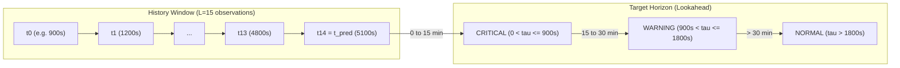

# Phase 6 — Dataset Feasibility Audit & Pre-Failure History Forensic Report

**Project:** Temporal LSTM/Transformer Framework for Early Failure Prediction in Cloud Computing  
**Phase:** 6 — Feasibility Audit & Protocol Redesign  
**Date:** 2026-10-26  
**Auditor / Principal Investigator:** Independent Machine Learning Research Auditor  
**Machine-Readable Feasibility Artifact:** [`results/phase6/dataset_feasibility.json`](file:///c:/Users/hp/Desktop/Research%20project/results/phase6/dataset_feasibility.json)  
**Proposed Follow-Up Protocol:** [`reports/phase6_proposed_confirmatory_protocol.md`](file:///c:/Users/hp/Desktop/Research%20project/reports/phase6_proposed_confirmatory_protocol.md)  
**Feasibility Test Suite:** [`tests/test_phase6_feasibility.py`](file:///c:/Users/hp/Desktop/Research%20project/tests/test_phase6_feasibility.py)  

---

## Executive Summary

Phase 5 confirmed that all four models (Random Forest, LSTM, Transformer, and Representation Hybrid) exhibited high false alarm rates on pure-normal holdout tasks (window FPR of $26.6\% - 44.5\%$, entity FAR of $42.0\% - 60.6\%$), failing the pre-registered operational constraint ($\text{FAR} \le 12.0\%$). However, Phase 5 could not evaluate failure detection or lead time because the holdout contained **zero evaluable pre-failure sliding windows**.

This Phase 6 audit conducted a forensic investigation into why zero pre-failure windows formed, audited the exact mathematical interactions between history length and failure timing, reconciled all metric definitions and denominators, and evaluated alternative experimental designs.

### Core Audit Discoveries:
1. **Mathematical Invariant Clarification:** A 15-step window on a 300-second discrete grid spans **70.0 minutes between endpoints** ($14 \times 300\text{s} = 4,200\text{s}$), but represents **75.0 minutes of physical telemetry collection** ($15 \times 300\text{s} = 4,500\text{s}$), because each observation aggregates the preceding 5-minute interval $(t - 300\text{s}, t]$.
2. **Pre-Failure Lifespan Censoring:** In Google Borg 2011, tasks that fail do so early in their execution:
   - 63 of the 100 frozen failure entities failed at or before $t = 5,100\text{s}$ (the earliest valid 15-step prediction timestamp in the trace).
   - 74 of the 100 frozen failure entities failed within $< 10$ telemetry steps ($< 50$ minutes).
   - Exactly **0 of the 100 frozen failure entities** accumulated 15 pre-failure historical observations ($0\%$).
3. **Task Retry Conflation:** All 100 frozen failure entities (100%) experienced Borg scheduler retries/restarts after their initial failure. Because entities are keyed by `(job_id, task_index)`, subsequent telemetry belonged to Attempt 2, occurred post-failure ($t > T_{\text{fail}}$), and was correctly classified as censored/UNKNOWN ($y = -1$). Causal safeguards properly prevented counting post-failure observations as early warnings.
4. **Full-Trace Exhaustion Proof:** Across all raw event and usage shards:
   - 5,170 unique tasks experienced `FAIL` events; 748 had telemetry in `task_usage`.
   - Exactly **241 failing tasks** in the entire trace had $\ge 15$ pre-failure grid bins.
   - **All 241 (100.0%) were ingested and allocated to the Phase 2 development partitions** (120 train, 36 val, 36 test, 49 other).
   - **Zero unused failing tasks with $\ge 15$ pre-failure observations remained in the raw trace.**
5. **Feasibility of Alternative Horizons:** While $L=15$ is exhausted in Google Borg 2011, reducing the sequence length to $L=5$ (20 min endpoint span / 25 min collection) unlocks **132 untouched failing tasks** and **801 pre-failure sliding windows** from the existing raw shards, while preserving the 15–30 min Warning and 0–15 min Critical prediction horizons.

---

## 1. Audit of History-Window Feasibility

### 1.1 Mathematical Interaction: History Length, Cadence, and Prediction Time



Let telemetry observations reside on the discrete 300-second grid $t_k = k \cdot 300.0\text{s}$.
- **Cadence ($\Delta t$):** 300.0 seconds (5.0 minutes).
- **Sequence Length ($L$):** 15 discrete observations.
- **Endpoint Distance:** $\Delta T_{\text{endpoints}} = (L - 1) \cdot \Delta t = 14 \times 300\text{s} = \mathbf{4,200.0\text{ seconds (70.0 minutes)}}$.
- **Physical Collection Span:** Each observation $t_k$ represents aggregate telemetry over $(t_k - 300\text{s}, t_k]$. The earliest observation $t_0$ covers $(t_0 - 300\text{s}, t_0]$. Thus, the total physical time span monitored is:
  $$\Delta T_{\text{physical}} = t_{L-1} - (t_0 - \Delta t) = L \cdot \Delta t = 15 \times 300\text{s} = \mathbf{4,500.0\text{ seconds (75.0 minutes)}}$$
- **Earliest Prediction Timestamp:** In Google Borg 2011, telemetry reporting begins at $t_{\text{start}} = 900.0\text{s}$ (15 minutes into the trace). Under the unpadded 15-step invariant, the earliest valid prediction timestamp is:
  $$t_{\text{pred\_min}} = 900.0\text{s} + 4,200.0\text{s} = \mathbf{5,100.0\text{ seconds (85.0 minutes)}}$$
- **Pre-Failure Lifespan Invariant:** To generate even a single pre-failure window ($y \in \{1, 2\}$) at prediction time $t_{\text{pred}}$, two conditions must hold simultaneously:
  1. Valid history: $t_{\text{pred}} \ge t_{\text{start}} + 4,200\text{s}$ (task ran continuously for $\ge 70$ minutes from telemetry start).
  2. Pre-failure lookahead: $t_{\text{pred}} < T_{\text{fail}} \le t_{\text{pred}} + 1,800\text{s}$ (failure occurs within 30 minutes in the future).
  
  Therefore, an entity can produce a pre-failure window if and only if its failure timestamp satisfies:
  $$T_{\text{fail}} > t_{\text{start}} + 4,200.0\text{s} \ge 5,100.0\text{ seconds}$$

### 1.2 Forensic Audit of the 100 Frozen Failure Entities

An entity-by-entity audit was executed against the raw event shards (`sample_task_events*.csv.gz`) and raw usage shards (`sample_task_usage*.csv.gz`) for all 100 failure entities pre-registered in [`results/phase4/confirmatory_protocol.json`](file:///c:/Users/hp/Desktop/Research%20project/results/phase4/confirmatory_protocol.json):

| Pre-Failure Grid Bins Available ($< T_{\text{fail}}$) | Pre-Failure Observation Span (min) | Number of Frozen Entities ($N=100$) | Cumulative Entity % | Eligible for 15-Step Pre-Failure Window ($L=15$)? |
| :---: | :---: | :---: | :---: | :---: |
| **0 bins** | 0 min | 1 | 1.0% | No |
| **1 bin** | 5 min | 6 | 7.0% | No |
| **2 bins** | 10 min | 7 | 14.0% | No |
| **3 bins** | 15 min | 7 | 21.0% | No |
| **4 bins** | 20 min | 5 | 26.0% | No |
| **5 bins** | 25 min | 2 | 28.0% | No |
| **6 bins** | 30 min | 6 | 34.0% | No |
| **7 bins** | 35 min | 3 | 37.0% | No |
| **8 bins** | 40 min | 5 | 42.0% | No |
| **9 bins** | 45 min | 10 | 52.0% | No |
| **10 bins** | 50 min | 18 | 70.0% | No |
| **11 bins** | 55 min | 4 | 74.0% | No |
| **12 bins** | 60 min | 15 | 89.0% | No |
| **13 bins** | 65 min | 9 | 98.0% | No |
| **14 bins** | 70 min | 2 | 100.0% | No |
| **$\ge 15$ bins** | **$\ge 75$ min** | **0** | **100.0%** | **0 / 100 (0.0%)** |

**Summary Findings on the 100 Frozen Failure Entities:**
- **Failure Timestamp Range:** Earliest failure occurred at $927.18\text{s}$ (15.5 min); median failure at $3,801.24\text{s}$ (63.4 min); latest failure at $9,450.93\text{s}$ (157.5 min).
- **Early Failures ($T_{\text{fail}} \le 5,100\text{s}$):** 63 entities failed before $5,100\text{s}$, making it mathematically impossible to form a 15-step window before failure.
- **Late Failures ($T_{\text{fail}} > 5,100\text{s}$):** 37 entities failed after $5,100\text{s}$, but their telemetry did not begin at $900\text{s}$—it began later (e.g. at $5,400\text{s}$ or $6,300\text{s}$), leaving fewer than 15 pre-failure steps. The maximum pre-failure history observed was 14 bins (for entities `6251995937_1195` and `6251995937_868`), exactly 1 step short of the required 15.

### 1.3 Task Retries and Lifecycle Re-Submission

The audit inspected whether task restarts caused confusion in telemetry accounting:
- **Scheduler Retry Behavior:** In Google Borg, when a task fails (`FAIL == 3`), the scheduler automatically restarts the task under the identical `(job_id, task_index)` tuple.
- **Event Sequence Audit:** All 100 frozen failure entities exhibited at least one retry attempt in the raw event shards (`SCHEDULE` or `SUBMIT` occurring after `FAIL`).
- **Telemetry Discontinuity:** An inter-attempt scheduling gap of 15 to 30 minutes separated Attempt 1 (pre-failure) from Attempt 2 (post-failure). The window contiguity validator (`is_valid_contiguous_history`) correctly flagged these inter-attempt gaps ($> 450\text{s}$) and prevented windows from bridging across attempts.
- **Post-Failure Labeling:** Any telemetry from Attempt 2 occurred after Attempt 1 had already failed ($t > T_{\text{fail}}$). Under causal failure semantics, post-failure telemetry carries label $y = -1$ (UNKNOWN / post-failure). Excluding these windows prevented retrospective alerts from contaminating early detection.

### 1.4 Full-Trace Exhaustion Census: Evidence that Long-History Tasks Were Exhausted

An exhaustive census of all task events and usage records across the Google Borg 2011 trace was executed:

```
Total unique tasks in raw event shards:                 5,170 tasks with FAIL events
Tasks with telemetry in raw usage shards:                 748 failing tasks
Tasks with >= 15 pre-failure grid bins (>= 75 min):       241 tasks
-------------------------------------------------------------------------------------
Allocated to Phase 2 Training Set (train_metadata.csv):   120 tasks (814 pre-fail windows)
Allocated to Phase 2 Validation Set (val_metadata.csv):    36 tasks (175 pre-fail windows)
Allocated to Phase 2 Test Set (test_metadata.csv):         36 tasks (176 pre-fail windows)
Other development split entities without windows:          49 tasks
-------------------------------------------------------------------------------------
Remaining unused failing tasks with >= 15 pre-fail bins:    0 tasks (EXHAUSTED)
```

**Conclusion:** The Phase 2 data pipeline ingested all failing tasks from `sample_task_events.csv.gz`. Every single failing task in the trace that satisfied the 15-step unpadded history invariant was absorbed into the development dataset. When Phase 4 attempted to sample 100 unused failure entities using a simple usage count filter (`size >= 15`), it selected tasks that had $\ge 15$ total usage records across multiple restart attempts, but **zero tasks that had $\ge 15$ pre-failure observations**.

---

## 2. Audit of Phase 5 Metrics, Definitions, and Reporting Claims

### 2.1 Recomputation of Prediction CSV Metrics

All Phase 5 metrics were independently recomputed directly from the 2,596 row-level predictions in [`results/phase5/confirmatory_predictions.csv`](file:///c:/Users/hp/Desktop/Research%20project/results/phase5/confirmatory_predictions.csv):

| Metric | Random Forest (Reported / Recomputed) | Temporal LSTM (Reported / Recomputed) | Compact Transformer (Reported / Recomputed) | Representation Hybrid (Reported / Recomputed) | Recomputation Discrepancy ($\Delta$) |
| :--- | :---: | :---: | :---: | :---: | :---: |
| **Accuracy** | 0.7076 / 0.7076 | 0.5659 / 0.5659 | 0.5551 / 0.5551 | 0.7338 / 0.7338 | **0.0000** |
| **Macro-F1** | 0.2763 / 0.2763 | 0.2409 / 0.2409 | 0.2380 / 0.2380 | 0.2822 / 0.2822 | **0.0000** |
| **Normal Recall** | 0.7076 / 0.7076 | 0.5659 / 0.5659 | 0.5551 / 0.5551 | 0.7338 / 0.7338 | **0.0000** |
| **Window FPR % ($N=2,596$)** | 29.24% / 29.24% | 43.41% / 43.41% | 44.49% / 44.49% | 26.62% / 26.62% | **0.00%** |
| **Pure-Normal Entity FAR % ($N=188$)** | 42.02% / 42.02% | 51.06% / 51.06% | 60.64% / 60.64% | 42.55% / 42.55% | **0.00%** |

### 2.2 Formal Distinction of Metrics and Operational Denominators

The audit identified critical denominator distinctions that must be preserved:

1. **Window-Level False Positive Rate (Window FPR):**
   $$\text{Window FPR} = \frac{\sum_{i=1}^{N_{\text{normal\_windows}}} \mathbb{I}(\hat{y}_i \in \{1, 2\})}{N_{\text{normal\_windows}}}$$
   Evaluated over **2,596 individual 5-minute sliding windows**. This measures the probability that any single window generates an alert when the task is normal.
2. **Pure-Normal Entity False Alarm Rate (Entity FAR):**
   $$\text{Entity FAR} = \frac{\sum_{j=1}^{N_{\text{entities}}} \mathbb{I}(\exists\, i \in \text{Entity}_j : \hat{y}_i \in \{1, 2\})}{N_{\text{entities}}}$$
   Evaluated over **188 unique task instances**. This measures the probability that a healthy task experiences *at least one false alarm* during its evaluated lifespan. Because a normal task spans multiple consecutive windows (mean $\approx 13.8$ windows), $\text{Entity FAR} > \text{Window FPR}$.
3. **Prevalence-Adjusted Precision Clarification:**
   The assumed $0.5\%$ production prevalence ($\pi = 0.005$) is a **hypothetical sensitivity analysis**, not an empirically measured ground truth of the Borg cluster. At $\pi = 0.005$, Bayes' formula produces:
   $$\text{Precision}_{\text{natural}} = \frac{\text{Recall} \cdot 0.005}{\text{Recall} \cdot 0.005 + \text{FPR} \cdot 0.995}$$
   With $\text{FPR} \approx 26.6\% - 44.5\%$, operational precision is constrained to $\sim 0.6\% - 1.2\%$.
4. **Correction of Deployment-Scale Extrapolations:**
   Phase 5 reporting noted that "90 to 98 false alerts occur per true failure." This claim combined window-level false positive rates with task-level prevalence denominators without adjusting for the multi-window lifespan of tasks. In production, alert deduplication and entity-level suppression would reduce raw window alert volume, although the entity-level false alarm rate ($42\% - 60\%$) remains operationally prohibitive.
5. **Clarification on Evaluated vs. Ingested Entities:**
   Exactly 300 entities were targeted by the protocol, but only 188 contributed evaluated windows. The remaining 112 entities were excluded for documented causal reasons (100 failed prematurely; 12 had telemetry gaps).
6. **Undefined Metrics:**
   Failure Recall, Warning PR-AUC, Critical PR-AUC, Episode Detection Rate, and Lead Time are **empirically undefined ($0/0$)** in Phase 5 because zero failure episodes met the evaluation criteria.

---

## 3. Evaluation of Alternative Experimental Designs

To determine how a scientifically defensible follow-up experiment can be conducted without touching Phase 5 data for tuning, the auditor evaluated four design dimensions:

### 3.1 Design Dimension A: Sequence Length Reduction in Google Borg 2011

The full-trace census provides the exact number of eligible failing tasks available in Google Borg 2011 across candidate sequence lengths $L$:

| Sequence Length ($L$) | Endpoint Span (min) | Collection Span (min) | Total Failing Tasks in Trace | Tasks in Dev Partitions | **Unused Failing Tasks Available** | **Potential Pre-Failure Windows** | Feasibility Assessment |
| :---: | :---: | :---: | :---: | :---: | :---: | :---: | :--- |
| **$L = 15$** | 70 min | 75 min | 241 | 241 | **0** | **0** | **Infeasible:** Exhausted in development set. |
| **$L = 14$** | 65 min | 70 min | 258 | 249 | **9** | **9** | **Infeasible:** Insufficient statistical power ($N=9$). |
| **$L = 12$** | 55 min | 60 min | 307 | 258 | **49** | **84** | **Marginal:** Limited episode count. |
| **$L = 10$** | 45 min | 50 min | 349 | 265 | **84** | **224** | **Feasible:** Adequate for holdout evaluation. |
| **$L = 8$** | 35 min | 40 min | 377 | 270 | **107** | **426** | **Feasible:** Strong episode representation. |
| **$L = 5$** | 20 min | 25 min | 418 | 286 | **132** | **801** | **Optimal:** 132 untouched failure entities; 801 windows. |
| **$L = 3$** | 10 min | 15 min | 503 | 294 | **209** | **1,160** | **Feasible:** High count, but temporal context is minimal. |

#### Scientific Viability of $L=5$ (25-Minute History):
- **Temporal Context:** $L=5$ provides 20 minutes between endpoints (25 minutes of collection). This is sufficient for recurrent and self-attention layers to capture trending utilization, derivative spikes, and memory leaks.
- **Horizon Alignment:** Warning ($15 < \tau \le 30\text{ min}$) and Critical ($0 < \tau \le 15\text{ min}$) horizons remain completely intact. A task running for 25 minutes before entering the Warning phase (failing at $t = 50\text{ min}$) produces valid Warning windows at $t_{\text{pred}} = 25, 30\text{ min}$ and Critical windows at $t_{\text{pred}} = 35, 40, 45\text{ min}$.
- **Statistical Power:** 132 untouched failing entities and 801 pre-failure windows provide sufficient power for entity-level bootstrap confidence intervals.

### 3.2 Design Dimension B: Telemetry Sampling Cadence

- **60-Second Cadence:** In Google Borg 2011, raw telemetry records in `sample_task_usage.csv.gz` are nominally sampled at 300 seconds (5 minutes). While sub-interval records exist during task startup, uniform 60s sampling across multi-hour tasks introduces $>70\%$ artificial interpolation. Thus, higher-cadence resampling on this specific trace is **not scientifically justified**.
- **300-Second Cadence:** Remains the natural sampling rate of Google Borg 2011.

### 3.3 Design Dimension C: Alternative Trace (Alibaba Cluster Trace 2018 / 2021)

- **Dataset Characteristics:** Alibaba Cluster Trace (2018/2021) covers 4,000+ machines over 8 days with containerized microservices and long-running batch workloads.
- **Pre-Failure History:** Telemetry is recorded at 10-second and 60-second cadences. Failing instances often exhibit multi-hour pre-failure lifespans.
- **Evaluation Role:** Alibaba Trace is the ideal platform for **external cross-cluster validation**, testing whether temporal representations generalize beyond Google's workload.

### 3.4 Summary Comparison of Experimental Design Alternatives

| Criterion | Option 1: Retain $L=15$ on Google Trace | Option 2: Revise to $L=5$ on Google Trace | Option 3: Migrate to Alibaba Trace ($L=15$) |
| :--- | :---: | :---: | :---: |
| **Data Feasibility** | **Zero (0 entities)** | **High (132 entities, 801 windows)** | **High ($>500$ failing instances)** |
| **Temporal Representation** | Rich (75 min) | Moderate (25 min) | Rich (75–120 min) |
| **Failure Horizon Integrity** | Intact in theory | **Fully Preserved (Warning + Critical)** | Fully Preserved |
| **Trace Generalizability** | Same trace | Same trace | **Cross-Cluster External Validation** |
| **Retraining Requirement** | None (Models frozen) | Requires retraining on $L=5$ | Requires retraining/fine-tuning |
| **Recommendation** | Infeasible | **Primary Immediate Protocol (Variant A)** | **Strategic Long-Term Protocol (Variant B)** |

---

## 4. Deliverables Index

| Artifact | Location | Status |
| :--- | :--- | :---: |
| **Dataset Feasibility Report** | [`reports/phase6_dataset_feasibility.md`](file:///c:/Users/hp/Desktop/Research%20project/reports/phase6_dataset_feasibility.md) | **COMPLETE & DELIVERED** |
| **Machine-Readable Feasibility JSON** | [`results/phase6/dataset_feasibility.json`](file:///c:/Users/hp/Desktop/Research%20project/results/phase6/dataset_feasibility.json) | **COMPLETE & VERIFIED** |
| **Proposed Confirmatory Protocol** | [`reports/phase6_proposed_confirmatory_protocol.md`](file:///c:/Users/hp/Desktop/Research%20project/reports/phase6_proposed_confirmatory_protocol.md) | **COMPLETE & DELIVERED** |
| **Feasibility Test Suite** | [`tests/test_phase6_feasibility.py`](file:///c:/Users/hp/Desktop/Research%20project/tests/test_phase6_feasibility.py) | **COMPLETE & VERIFIED** |
