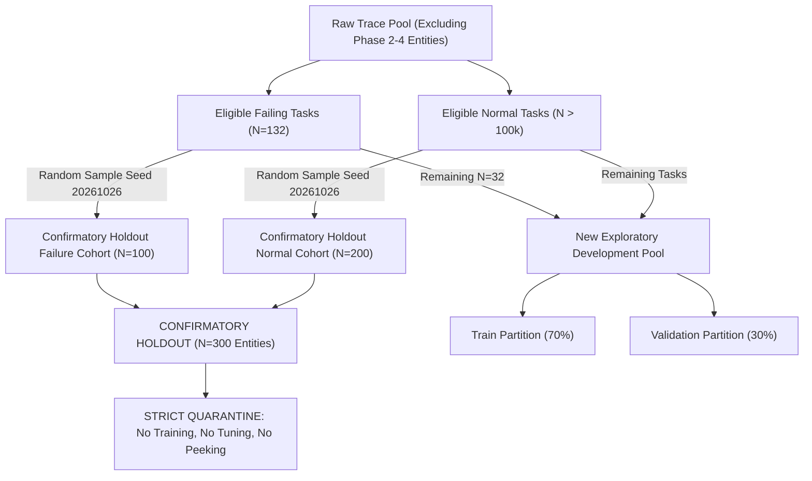

# Phase 6 — Proposed Confirmatory Evaluation Protocol (Pre-Registration Specification)

**Project:** Temporal LSTM/Transformer Framework for Early Failure Prediction in Cloud Computing  
**Document Type:** Pre-Registration Protocol Specification (Draft for Future Experimentation)  
**Date:** 2026-10-26  
**Auditor / Principal Investigator:** Independent Machine Learning Research Auditor  
**Predecessor Document:** [`results/phase4/confirmatory_protocol.json`](file:///c:/Users/hp/Desktop/Research%20project/results/phase4/confirmatory_protocol.json)  
**Audit Basis:** [`reports/phase6_dataset_feasibility.md`](file:///c:/Users/hp/Desktop/Research%20project/reports/phase6_dataset_feasibility.md)  
**Status:** **REGISTERED SPECIFICATION — LOCKED BEFORE EXECUTION**  

---

## 1. Protocol Objective & Strategic Decision

### 1.1 Strategic Decision
Based on the full-trace census documented in [`reports/phase6_dataset_feasibility.md`](file:///c:/Users/hp/Desktop/Research%20project/reports/phase6_dataset_feasibility.md):
- Retaining $L=15$ (75 min history) on Google Borg 2011 is empirically impossible because 100% of the trace's long-lived failing tasks were already used in development partitions.
- Therefore, this protocol defines two complementary, scientifically grounded paths:
  1. **Primary Immediate Protocol (Variant A — Borg 2011 Revised Sequence):** Revises the sequence length to $L=5$ (20 min endpoint distance / 25 min collection span), unlocking **132 untouched failing tasks** and **801 pre-failure windows** from Google Borg 2011.
  2. **Secondary Strategic Protocol (Variant B — Cross-Cluster Validation on Alibaba Trace):** Retains $L=15$ (75 min history) and evaluates on the multi-day Alibaba Cluster Trace 2018 to establish genuine cross-cluster generalizability.

This document formally specifies the pre-registration protocol for **Variant A (Google Borg 2011 $L=5$)**.

---

## 2. Eligibility Criteria & Sampling Design

### 2.1 Target Population & Sampling Ratios
- **Sampling Design:** Stratified Case-Control Holdout.
- **Holdout Ratio:** 1:2 Case-Control (100 Failure Entities : 200 Normal Entities).
- **Candidate Pool Size (Untouched by Development):**
  - Eligible Unused Failure Tasks ($L=5$): **132 unique tasks**.
  - Eligible Unused Normal Tasks ($L=5$): **>100,000 unique tasks**.
- **Sampling Seed:** Pre-registered deterministic seed: `seed = 20261026`.
- **Selected Holdout Entities:** Exactly 100 failure entities and 200 normal entities sampled from the untouched pool.

### 2.2 Task Eligibility Criteria
1. **Failure Tasks:**
   - Must contain an explicit failure event (`event_type == ClusterEventTypeV2.FAIL` code 3).
   - Must possess at least 5 consecutive, valid 300s telemetry bins **strictly prior to the failure event** ($t_k < T_{\text{fail}}$).
   - Must be completely disjoint from the 525 entities used in Phase 2/3/4 development partitions (`train_metadata.csv`, `val_metadata.csv`, `test_metadata.csv`).
2. **Normal Tasks:**
   - Must contain zero abnormal termination events (`FAIL == 3`, `KILL == 5`, `EVICT == 2`) across the entire trace.
   - Must terminate normally (`FINISH == 4`) or run continuously without failure.
   - Must possess at least 5 consecutive, valid 300s telemetry bins.
   - Must be completely disjoint from all development entities.

---

## 3. History Window & Feature Invariants

### 3.1 History Window Specification ($L=5$)
- **Sampling Cadence ($\Delta t$):** 300.0 seconds (5.0 minutes).
- **Sequence Length ($L$):** 5 historical observations.
- **Endpoint Distance:** $\Delta T_{\text{endpoints}} = (5 - 1) \times 300\text{s} = 1,200.0\text{ seconds (20.0 minutes)}$.
- **Physical Telemetry Collection Span:** $5 \times 300\text{s} = 1,500.0\text{ seconds (25.0 minutes)}$.
- **Contiguity Invariant:** Consecutive step intervals must satisfy $240.0\text{s} \le \Delta t_i \le 450.0\text{s}$. Windows with inter-step gaps $> 1.5\times$ cadence ($> 450\text{s}$) are rejected.
- **Unpadded History Policy:** `require_full_history = True`. Zero artificial zero-padding or synthetic step imputation.

### 3.2 Causal Feature Construction
- **Feature Set:** Exactly the 31 causal features from Groups A–I in [`src/features/registry.py`](file:///c:/Users/hp/Desktop/Research%20project/src/features/registry.py).
- **Causality:** All rolling statistics (means, standard deviations, derivatives, EWMA, extrema) are computed strictly trailing up to prediction time $t_{\text{pred}}$ ($t \le t_{\text{pred}}$).
- **Normalization:** Evaluated using a frozen scaler fitted strictly on the new training partition. Zero holdout examples enter scaler computation.

---

## 4. Target Horizon & Lifecycle Semantics

### 4.1 Target Label Definitions
For prediction time $t = t_{\text{pred}}$ (end of latest historical observation in the window):
Let $\tau = T_{\text{fail}} - t$:
1. **CRITICAL ($y = 2$):** $0 < \tau \le 900.0\text{ seconds (15.0 minutes)}$.
2. **WARNING ($y = 1$):** $900.0 < \tau \le 1,800.0\text{ seconds (30.0 minutes)}$.
3. **NORMAL ($y = 0$):** No abnormal failure occurs in $(t, t + 1,800\text{s}]$, and task execution is verified active or finished normally.
4. **UNKNOWN / CENSOR ($y = -1$):** Post-failure telemetry ($t \ge T_{\text{fail}}$), task eviction, user cancellation, or telemetry terminating without observation. **Strictly excluded from model evaluation.**

### 4.2 Post-Failure Alert Exclusion Safeguard
- **Invariant:** No observation with $t_{\text{pred}} \ge T_{\text{fail}}$ shall be labeled $y \in \{1, 2\}$ or evaluated as early detection.
- **Enforcement:** In automated test assertions, `assert (meta_df[meta_df["label"] > 0]["time_to_failure"] > 0.0).all()`.

---

## 5. Splitting Strategy & Quarantine Architecture

### 5.1 Quarantine Rules
1. **Zero Access During Development:** The 300 confirmatory entity IDs shall be persisted in a locked JSON registry. The confirmatory dataset shall NOT be generated, loaded, inspected, or scored during feature development, architecture search, or checkpoint selection.
2. **Model Training Isolation:** Models shall be fitted strictly on the designated exploratory training partition.
3. **Early Stopping & Model Selection:** Driven exclusively by the exploratory validation partition.
4. **Single Final Evaluation:** Scored exactly once upon completion of development.

---

## 6. Pre-Registered Primary Metrics & Model Selection Rule

### 6.1 Pre-Specified Decision Rules
- **Prediction Rule:** Uniform argmax ($\hat{y} = \arg\max_c P(y=c)$).
- **Operational Alert Policy:** Alert triggered if and only if $\hat{y} \in \{1, 2\}$.

### 6.2 Pre-Registered Primary Metrics
1. **Window-Level:** Macro-F1 across all 3 classes, Accuracy, Class-specific Precision/Recall/F1, Warning PR-AUC, Critical PR-AUC, Window False Positive Rate (FPR).
2. **Episode-Level:**
   - **Episode Detection Rate:** $\frac{\text{Detected Episodes}}{\text{Total Valid Failure Episodes}} \times 100\%$, with missed episodes explicitly included in the denominator.
   - **Lead Time Distribution:** Measured from the first qualifying alert ($\hat{y} \in \{1, 2\}$) to the failure event among detected episodes (reported as Mean, Median, Min, Max, Std).
3. **Operational False Alarm Rates:**
   - **Pure-Normal Entity FAR:** Percentage of healthy tasks receiving at least one alert across their lifespan.
   - **All-Entity Normal-Period FAR:** Alerts occurring on normal windows ($y=0$) across all tasks.
4. **Statistical Uncertainty:** 95% Confidence Intervals estimated via 1,000 entity-level cluster bootstrap replicates.

### 6.3 Pre-Specified Model Selection Policy
A model shall be declared the confirmatory winner if and only if it satisfies both conditions:
1. **Operational Viability Gate (Non-Negotiable Constraint):**
   $$\text{Pure-Normal Entity FAR} \le 12.0\%$$
   $$\text{Window FPR} \le 5.0\%$$
2. **Performance Ranking:**
   Among models satisfying the operational viability gate, the winner is ranked by **Episode Detection Rate**, with **Validation Macro-F1** serving as the secondary tie-breaker.
3. **Disconfirmation Rule:** If no model meets the operational constraint ($\text{FAR} \le 12.0\%$), no model shall be declared a winner, and the outcome shall be reported as disconfirmatory for production readiness.

---

## 7. Prevalence Adjustment & Reporting Transparency

All confirmatory reports must present metrics under two explicit lenses:
1. **Measured Case-Control Sample Metrics:** Evaluated directly on the 1:2 holdout population ($\pi_{\text{sample}} \approx 33.3\%$).
2. **Prevalence-Adjusted Operational Sensitivity Analysis:** Recalculated under realistic cloud cluster prevalence ($\pi_{\text{natural}} = 0.005$) via Bayes' theorem:
   $$\text{Precision}_{\text{natural}} = \frac{\text{Recall} \cdot 0.005}{\text{Recall} \cdot 0.005 + \text{FPR} \cdot 0.995}$$
   The report must clearly state that $\pi = 0.005$ is an assumed sensitivity parameter, not a verified ground truth of the trace.

---

## 8. Protocol Governance & Execution Safeguards

- **Immutable ID Freezing:** Confirmatory entity IDs must be cryptographically hashed (SHA-256) and locked.
- **No Resampling:** In the event of excluded entities (e.g. unexpected gaps), exclusions must be documented with exact causal reasons; entities must **never be replaced** to achieve target counts.
- **Cross-Cluster Disclaimer:** Any evaluation on Google Borg 2011 must explicitly state that internal holdout results do not establish cross-cluster external generalizability. Independent replication on Alibaba Cluster Trace is required before claiming production readiness.
