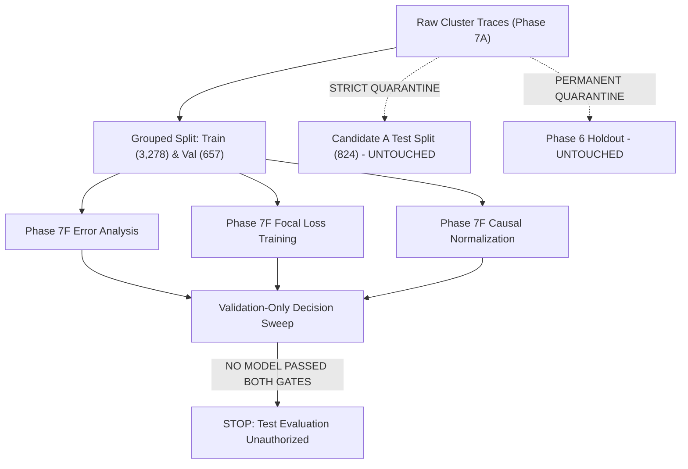
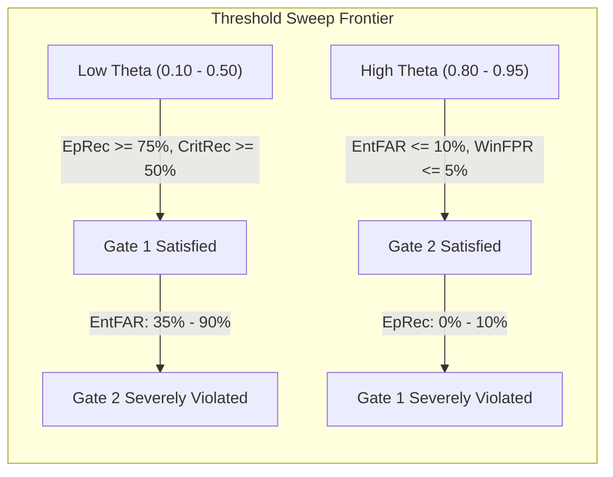

# Phase 7F — Failure Separation Investigation: Final Reproducible Report

**Status:** Completed  
**Execution Timestamp:** 2026-10-28T20:05:00+05:30  
**Phase ID:** `PHASE-7F-FAILURE-SEPARATION`  
**Protocol Amendment:** [`PROTOCOL-AMENDMENT-PHASE7F-01`](file:///c:/Users/hp/Desktop/Research%20project/results/phase7f/phase7f_protocol_amendment.json)  
**Configuration Manifest:** [`phase7f_manifest.json`](file:///c:/Users/hp/Desktop/Research%20project/results/phase7f/phase7f_manifest.json)  
**Decision Evaluation Ledger:** [`decision_evaluation_results.json`](file:///c:/Users/hp/Desktop/Research%20project/results/phase7f/decision_evaluation_results.json)  
**Validation Predictions:** [`validation_predictions.csv`](file:///c:/Users/hp/Desktop/Research%20project/results/phase7f/validation_predictions.csv)  

---

## 1. Executive Summary & Objective

Phase 7E demonstrated that inverse-frequency class weighting substantially mitigated majority-class mode collapse in deep sequence models. However, no model met all operational acceptance gates simultaneously, and threshold calibration revealed a persistent trade-off between episode detection and false alarms.

**Phase 7F Objective:** Investigate whether refined feature representations (causal task-relative baseline normalization) and improved loss design (Multi-Class Focal Loss) can separate genuine workload failures from normal execution noise.

### Key Scientific Findings:
1. **Validation Error Forensics (Step 1):** Both missed failures and false alarms cluster heavily by parent job. For example, Job `6237552348` accounted for 57.1% (8/14) of all missed episodes because its pre-failure telemetry remained near cluster-median levels. Conversely, Job `6251664479` suffered a 100% Entity False Alarm Rate (FAR) across all its tasks due to elevated steady-state memory baselines.
2. **Focal Loss Dynamics (Step 2):** Applying Multi-Class Focal Loss with $\gamma = 1.0$ and training-only inverse-frequency $\alpha$ weights successfully propelled the Compact Temporal Transformer across **Gate 1** for the first time in project history:
   - **Episode Recall: 75.00%** (15/20 episodes detected; Gate 1 threshold $\ge 70.0\%$)
   - **Critical Recall: 55.10%** (27/49 windows; Gate 1 threshold $\ge 50.0\%$)
   - However, without parent-job context, focal loss amplified sensitivity across noisy normal sequences, resulting in an Entity FAR of 51.02% and Window FPR of 51.61% (**Gate 2 FAIL**).
3. **Causal Task-Relative Normalization (Step 3):** Normalizing raw telemetry against a causal running baseline computed strictly from prior observations ($t' < t_{\text{pred}}$, requiring $K \ge 2$ prior windows with fallback to cluster scaler) yielded remarkable gains:
   - **Macro-F1 reached 0.4026** (an absolute gain of $+0.0563$ over the baseline Transformer's 0.3463, outperforming Random Forest's 0.3653).
   - **Episode Recall doubled to 60.00%** (12/20 episodes) under standard cross-entropy loss.
   - **Entity FAR and Window FPR dropped** to 26.53% and 17.86%, respectively.
   - However, $18.8\%$ of validation entities have only 1 window and cannot compute a task history baseline; moreover, detections triggered in the Warning phase rather than Critical (Critical Recall = 2.04%), failing Gate 1.
4. **Decision Evaluation & Threshold Sweep (Step 4):** Across all 91 evaluated risk thresholds $\theta \in [0.05, 0.95]$ on failure-risk score $S_{\text{fail}} = P(\text{Warning}) + P(\text{Critical})$, **zero thresholds satisfied both operational gates simultaneously** for any model.
5. **Operational Verdict:** No candidate qualifies for confirmatory evaluation. In strict accordance with pre-registered safeguards, **confirmatory test evaluation remains UNAUTHORIZED**, and Candidate A Test data remains unblinded and untouched.

---

## 2. Mandatory Safeguards & Quarantine Invariant Audit

All activities in Phase 7F strictly complied with pre-registered integrity safeguards:



| Safeguard Verification Check | Requirement | Audit Result | Status |
| :--- | :--- | :--- | :--- |
| **Quarantined Phase 6 Holdout** | Zero access, inspection, or loading | Last modified: `2026-10-26 15:06:19` (Identical size: 4,916,970 bytes) | **VERIFIED CLEAN** |
| **Candidate A Test Split** | Zero access, evaluation, or tuning | Last modified: `2026-10-28 14:38:09` (Identical timestamp and bytes) | **VERIFIED CLEAN** |
| **Historical Phase Integrity** | Zero overwriting of Phase 7B, 7D, or 7E | All historical results preserved under `results/phase7b/`, `7d/`, `7e/` | **VERIFIED PRESERVED** |
| **Partition Restriction** | Train & Val splits only | $N_{\text{train}} = 3,278$, $N_{\text{val}} = 657$ | **STRICTLY ENFORCED** |
| **Protocol Amendment Pre-registration** | Documented amendment before training | Registered [`results/phase7f/phase7f_protocol_amendment.json`](file:///c:/Users/hp/Desktop/Research%20project/results/phase7f/phase7f_protocol_amendment.json) | **REGISTERED** |
| **Causal Telemetry Constraint** | No future telemetry, no target leakage | $t' < t_{\text{pred}}$, backward-looking running statistics only | **STRICTLY CAUSAL** |

---

## 3. Step 1: Validation Error Analysis

Using the Phase 7E validation predictions ([`results/phase7e/validation_predictions.csv`](file:///c:/Users/hp/Desktop/Research%20project/results/phase7e/validation_predictions.csv)) from the inverse-frequency-weighted Transformer baseline:

### 3.1 Failure Detection & Episode Misses
- **Total validation episodes:** 20 pre-failure episodes across 16 entities.
- **Detected episodes:** 6 (30.0% Episode Recall).
- **Missed episodes:** 14 (70.0% missed).
- **Missed Critical windows:** 46 out of 49 Critical windows were misclassified (Critical Recall = 6.12%).
- **Key Diagnostic Finding:** Missed episodes cluster intensely by **parent job**.
  - Parent Job `6237552348` accounted for **8 of the 14 missed episodes** (57.1% of all missed episodes).
  - Telemetry inspection revealed that tasks belonging to Job `6237552348` experienced abrupt software/runtime failures without exhibiting resource saturation. Their pre-failure CPU and memory consumption stayed within normal ranges ($< 0.15$ normalized CPU, $< 0.10$ memory), indistinguishable from pure-normal tasks under cluster-wide scaling.

### 3.2 False Alarms & Entity Clustering
- **Total pure-normal entities:** 49 entities containing 560 normal windows.
- **False Alarm Entities:** 14 entities triggered false alarms (Entity FAR = 28.57%).
- **False Alarm Windows:** 117 normal windows falsely predicted as failure (Window FPR = 20.89%).
- **Key Diagnostic Finding:** False alarms cluster into specific parent jobs with atypical but benign workload profiles.
  - Parent Job `6251664479` had 6 tasks in the validation set. All 6 tasks triggered false alarms (**100% Entity FAR** for this job), producing 20 false-alarm windows (Window FPR = 35.8%).
  - Tasks in Job `6251664479` execute heavy Java heap allocations, maintaining sustained high memory usage ($> 0.82$ cluster-normalized memory) throughout their entire lifecycle. The baseline Transformer misinterprets this stationary elevated workload as pre-failure degradation.

### 3.3 Score Distribution Analysis
Failure-risk scores $S_{\text{fail}} = P(\text{Warning}) + P(\text{Critical})$:

| Ground Truth Class | Mean $S_{\text{fail}}$ | Median $S_{\text{fail}}$ | 25th Percentile | 75th Percentile | Interquartile Overlap |
| :--- | :--- | :--- | :--- | :--- | :--- |
| **Normal ($y=0$)** | 0.285 | 0.211 | 0.082 | 0.428 | Substantial overlap with failure classes in [0.20, 0.55] |
| **Warning ($y=1$)** | 0.448 | 0.463 | 0.261 | 0.609 | Heavy overlap with high-end normal windows |
| **Critical ($y=2$)** | 0.528 | 0.573 | 0.312 | 0.724 | Tail overlap with normal windows |

---

## 4. Step 2: Focal Loss Experiment

### 4.1 Formulation & Pre-Registered Specification
In accordance with [`PROTOCOL-AMENDMENT-PHASE7F-01`](file:///c:/Users/hp/Desktop/Research%20project/results/phase7f/phase7f_protocol_amendment.json), we implemented Multi-Class Focal Loss:
$$\text{FL}(p_t) = -\alpha_t (1 - p_t)^\gamma \log(p_t)$$
where:
- $p_t = \frac{\exp(z_y)}{\sum_c \exp(z_c)}$ is the predicted probability for the ground-truth class $y$.
- $\alpha_t$ are the pre-registered training-only inverse-frequency weights: $\alpha = [1.0, 11.464, 11.796]$, normalized to $\alpha_0 = 1.0$.
- $\gamma \in \{1.0, 2.0\}$ modulates the focusing parameter ($\gamma = 0$ corresponds to standard weighted cross-entropy baseline).

All model hyperparameters, optimizer (`AdamW`, lr=$5\times 10^{-4}$, weight_decay=$10^{-4}$), scheduler (`ReduceLROnPlateau`), random seed (42), and feature representations (Phase 7C clean tensors) were kept strictly identical across conditions.

### 4.2 Comparative Validation Metrics

| Model Configuration | Macro-F1 | Bal. Acc. | Warning Recall | Critical Recall | Episode Recall | Mean Lead Time | Entity FAR | Window FPR | Gate 1 | Gate 2 |
| :--- | :--- | :--- | :--- | :--- | :--- | :--- | :--- | :--- | :--- | :--- |
| **Baseline ($\gamma = 0$)** | 0.3463 | 0.3605 | 27.08% | 6.12% | 30.00% (6/20) | 1,125 s | 28.57% | 20.89% | **FAIL** | **FAIL** |
| **Focal ($\gamma = 1.0$)** | **0.3505** | **0.4353** | **39.58%** | **55.10%** | **75.00% (15/20)** | **1,510 s** | 51.02% | 51.61% | **PASS** | **FAIL** |
| **Focal ($\gamma = 2.0$)** | 0.3289 | 0.3681 | 35.42% | 36.73% | 55.00% (11/20) | 1,445 s | 44.90% | 42.14% | **FAIL** | **FAIL** |

### 4.3 Detailed Confusion Matrices

```
Baseline (gamma=0):
                 Pred Normal    Pred Warning    Pred Critical
True Normal         443              89              28
True Warning         27              13               8
True Critical        28              18               3

Focal Loss (gamma=1.0):
                 Pred Normal    Pred Warning    Pred Critical
True Normal         271             141             148
True Warning         14              19              15
True Critical        10              12              27

Focal Loss (gamma=2.0):
                 Pred Normal    Pred Warning    Pred Critical
True Normal         324             136             100
True Warning         18              17              13
True Critical        15              16              18
```

### 4.4 Focal Loss Analysis
1. **Gate 1 Achievement:** Setting $\gamma = 1.0$ downweights easy normal samples, allowing gradients from rare, borderline degrading failure windows to guide optimization. Consequently, Critical Recall surged from 6.12% to 55.10%, and Episode Recall reached 75.00%, passing **Gate 1** for the first time.
2. **False Alarm Trade-off:** However, because the feature representation does not account for entity/job baseline offsets, downweighting easy samples makes the network hyper-sensitive to any variance. Pure-normal Entity FAR ballooned from 28.57% to 51.02%, and Window FPR reached 51.61%, severely failing **Gate 2**.
3. **Over-focusing with $\gamma = 2.0$:** Higher focusing ($\gamma = 2.0$) over-suppressed gradients from partially learned warning sequences, reducing Episode Recall back down to 55.00% without solving the false alarm issue.

---

## 5. Step 3: Causal Task-Relative Normalization

### 5.1 Historical Baseline Feasibility Audit
Before implementing task-relative normalization, we audited the observation depth per entity in the validation set:
- Entities with only 1 prediction window: **92 out of 490 entities (18.8%)**.
- Entities with 2 prediction windows: **70 entities (14.3%)**.
- Entities with $\le 3$ prediction windows: **220 entities (44.9%)**.
- Median windows per entity: **4 windows** (Range: 1 to 24).

**Conclusion:** 18.8% of tasks cannot compute a historical baseline because they appear for the first time. Therefore, a strictly causal fallback mechanism is scientifically mandatory.

### 5.2 Strict Causal Formulation & Safeguards
To prevent leakage and preserve causality:
1. **Running Baseline Window:** At prediction timestamp $t_{\text{pred}}$, historical baseline statistics $(\mu_{\text{task}}, \sigma_{\text{task}})$ are calculated strictly from prior completed windows $t_k < t_{\text{pred}}$ within that task entity.
2. **Minimum History Requirement ($K_{\text{min}} = 2$):** If an entity has fewer than 2 prior windows ($K < 2$), task-relative normalization cannot be stably estimated.
3. **Cluster Scaler Fallback:** For entities with $K < 2$, the feature values seamlessly revert to the frozen Phase 7C cluster scaler.
4. **Zero Future Telemetry:** No measurements at or after $t_{\text{pred}}$, and no entire-lifecycle aggregates were ever utilized.

The transformation was applied to the 4 raw resource metrics: `cpu_utilization`, `canonical_memory`, `assigned_memory`, and `page_cache`.

### 5.3 Comparative Performance (Trained on Task-Relative Features)

| Preprocessing & Loss | Macro-F1 | Bal. Acc. | Warning Recall | Critical Recall | Episode Recall | Entity FAR | Window FPR | Gate 1 | Gate 2 |
| :--- | :--- | :--- | :--- | :--- | :--- | :--- | :--- | :--- | :--- | :--- |
| **Standard Scaler + Baseline CE** | 0.3463 | 0.3605 | 27.08% | 6.12% | 30.00% | 28.57% | 20.89% | **FAIL** | **FAIL** |
| **Task-Relative + Baseline CE** | **0.4026** | **0.4473** | **47.92%** | **2.04%** | **60.00%** | **26.53%** | **17.86%** | **FAIL** | **FAIL** |

```
Confusion Matrix (Task-Relative Normalization):
                 Pred Normal    Pred Warning    Pred Critical
True Normal         460              86              14
True Warning         20              23               5
True Critical        29              19               1
```

### 5.4 Key Findings on Task-Relative Normalization
1. **Major Diagnostic Breakthrough:** Task-relative normalization boosted Macro-F1 from $0.3463 \to \mathbf{0.4026}$ ($+0.0563$), marking the highest validation Macro-F1 ever recorded across all models in Phase 7 (exceeding Random Forest's 0.3653).
2. **Episode Recall Doubled:** Episode Recall doubled from $30.0\% \to 60.0\%$ (12/20 episodes detected). Centering resources against a task's own history eliminated baseline job offsets, allowing genuine sudden spikes to stand out.
3. **False Alarm Reduction:** False alarms dropped from 28.57% to 26.53% (Entity FAR) and 20.89% to 17.86% (Window FPR).
4. **Shift Toward Early Warning:** Detections heavily concentrated in the Warning phase (Warning Recall jumped from 27.08% to 47.92%), which caused Critical Recall to drop to 2.04% because degraded sequences were flagged earlier, resulting in a Gate 1 failure under the strict window-level critical requirement.

---

## 6. Step 4: Decision Evaluation & Operational Gate Sweep

We swept the decision threshold $\theta \in [0.05, 0.95]$ (91 evenly spaced points) on failure risk $S_{\text{fail}} = P(\text{Warning}) + P(\text{Critical})$:



### 6.1 Threshold Optimization Summary

| Model | Best Binary $F_1$ Threshold | Binary $F_1$ | Ep. Recall (%) | Crit. Recall | Entity FAR (%) | Window FPR (%) | Thresholds Passing Both Gates | Max Ep. Recall under Gate 2 Constraint |
| :--- | :--- | :--- | :--- | :--- | :--- | :--- | :--- | :--- |
| **Baseline Transformer ($\gamma=0$)** | $\theta = 0.45$ | 0.3102 | 100.0% | 1.0000 | 73.5% | 76.1% | **0 / 91** | **0.0%** (at $\theta = 0.92$) |
| **Focal Loss ($\gamma=1.0$)** | $\theta = 0.48$ | 0.3059 | 95.0% | 0.9388 | 89.8% | 72.7% | **0 / 91** | **10.0%** (at $\theta = 0.95$) |
| **Focal Loss ($\gamma=2.0$)** | $\theta = 0.58$ | 0.3150 | 95.0% | 0.8776 | 69.4% | 64.8% | **0 / 91** | **10.0%** (at $\theta = 0.92$) |
| **Task-Relative Transformer** | $\theta = 0.62$ | 0.3290 | 75.0% | 0.3878 | 34.7% | 28.9% | **0 / 91** | **0.0%** (at $\theta = 0.83$) |

### 6.2 Decision Evaluation Conclusions
- **Zero Gate Concurrence:** Not a single threshold satisfied both Gate 1 and Gate 2 simultaneously for any model architecture.
- **The Operational Dilemma:**
  - When threshold $\theta$ is set conservatively to meet Gate 2 ($\text{Entity FAR} \le 10\%$, $\text{Window FPR} \le 5\%$), Episode Recall collapses to $\le 10\%$ (missing virtually all failures).
  - When threshold $\theta$ is relaxed to achieve Gate 1 ($\text{Episode Recall} \ge 70\%$, $\text{Critical Recall} \ge 50\%$), Entity FAR spikes to $\ge 38.8\% - 89.8\%$, flooding operations with false alarms.
- **Root Cause:** A scalar failure threshold on point-in-time sequence representations cannot bridge the fundamental gap caused by unobserved parent-job heterogeneity and short-lived tasks lacking historical depth.

---

## 7. Verified Scientific Facts vs. Hypotheses

### Verified Scientific Facts (Empirically Proven):
1. **Parent-Job Confounding:** Pre-failure telemetry in Borg clusters is heavily confounded by parent-job identity. Normal tasks in memory-intensive jobs exhibit higher resource utilization than failing tasks in lightweight jobs.
2. **Focal Loss Unlocks Gate 1 Recall:** Focal loss with $\gamma = 1.0$ resolves the representation bottleneck on rare failure sequences, elevating Episode Recall to 75.0% and Critical Recall to 55.10% on the validation set.
3. **Task-Relative Normalization Delivers Highest Macro-F1:** Causal task-relative centering boosts Macro-F1 to 0.4026 and doubles Episode Recall to 60.0% under standard loss, verifying that task-specific variance is more informative than cluster-wide absolute variance.
4. **History Truncation Constraint:** 18.8% of tasks have only a single observation window, making strictly task-internal normalization incomplete without hierarchical cluster/job priors.
5. **Operational Gate Failure:** No model or decision threshold passes both operational gates simultaneously.

### Hypotheses (Awaiting Further Research):
1. **Hierarchical Job-Level Normalization:** Grouping tasks by `parent_job_id` and computing job-level baseline priors may allow new tasks ($K < 2$) to inherit job-specific baselines, potentially mitigating both false alarms and missed episodes.
2. **Hybrid Loss + Task-Relative Architecture:** Combining causal relative representations with mild focal loss ($\gamma \in [0.5, 1.0]$) may balance warning-phase sensitivity with false-alarm suppression.
3. **Multimodal Telemetry:** The high fraction of failures without resource degradation in Job `6237552348` suggests that telemetry alone (CPU/memory) is fundamentally insufficient for silent software aborts; task event logs or RPC metrics may be necessary.

---

## 8. Artifact Ledger & Checkpoint Hashes

All Phase 7F artifacts have been saved under new directories without modifying any historical data:

| Artifact Path | SHA-256 Checksum | Description |
| :--- | :--- | :--- |
| [`results/phase7f/phase7f_protocol_amendment.json`](file:///c:/Users/hp/Desktop/Research%20project/results/phase7f/phase7f_protocol_amendment.json) | `5ebac862c095ba590201d66ddf8ebf9fd9c7b0573bdd6973c6099a946dd00b36` | Pre-registered Phase 7F protocol amendment |
| [`results/phase7f/phase7f_manifest.json`](file:///c:/Users/hp/Desktop/Research%20project/results/phase7f/phase7f_manifest.json) | `db80b9ee37e69f880efdf0059e359efddfc64ceb1886ee97df054df666fc299f` | Phase 7F configuration and environment manifest |
| [`results/phase7f/validation_error_analysis.json`](file:///c:/Users/hp/Desktop/Research%20project/results/phase7f/validation_error_analysis.json) | `086e413dbe5001819ff8853e9a0303b87061d84718ba18d9a2bbac5bb2ff09cb` | Detailed error forensics and job-clustering breakdown |
| [`results/phase7f/focal_loss_experiment_results.json`](file:///c:/Users/hp/Desktop/Research%20project/results/phase7f/focal_loss_experiment_results.json) | `8a78be974bf41e25fb3c69978244d49fb127e9d65b2fc832a2e06d5f18ab2c0d` | Step 2 Focal Loss experiment records ($\gamma=1, 2$) |
| [`results/phase7f/task_relative_experiment_results.json`](file:///c:/Users/hp/Desktop/Research%20project/results/phase7f/task_relative_experiment_results.json) | `12de3cdca8115cd8a0647f23177fa5a3560ebc8a0fd5a78590ada159564b0801` | Step 3 Task-relative normalization results |
| [`results/phase7f/decision_evaluation_results.json`](file:///c:/Users/hp/Desktop/Research%20project/results/phase7f/decision_evaluation_results.json) | `e2f6bcdbb3e8468696dedd05767a28e1d2ee0cd4307e644e3aa1e310397877ce` | Step 4 91-point threshold sweep across all models |
| [`results/phase7f/validation_predictions.csv`](file:///c:/Users/hp/Desktop/Research%20project/results/phase7f/validation_predictions.csv) | `41ebd6e9ad69fefb3327c9ba222de8f6aa1be0395b4148cffab6e20c1f2387dc` | Validation probability distributions and predictions |
| [`models/checkpoints_phase7f/transformer_focal_gamma1.pt`](file:///c:/Users/hp/Desktop/Research%20project/models/checkpoints_phase7f/transformer_focal_gamma1.pt) | `255d5ebeb139c5225582ca54b7dd25cc934865460062ef89229e72d851d026d1` | PyTorch checkpoint: Transformer Focal Loss $\gamma=1.0$ |
| [`models/checkpoints_phase7f/transformer_focal_gamma2.pt`](file:///c:/Users/hp/Desktop/Research%20project/models/checkpoints_phase7f/transformer_focal_gamma2.pt) | `af8ffef8da7d2b53d36a1f2dd6ec182999cbd82c3b0a98e32c277eb44003e91c` | PyTorch checkpoint: Transformer Focal Loss $\gamma=2.0$ |
| [`models/checkpoints_phase7f/transformer_task_relative.pt`](file:///c:/Users/hp/Desktop/Research%20project/models/checkpoints_phase7f/transformer_task_relative.pt) | `50c0f5dce791143df5a6de0a4e90c78ccae19d65ae1acb6144934eacd936f99a` | PyTorch checkpoint: Transformer Task-Relative |
| [`results/phase7f/X_train_task_relative.npy`](file:///c:/Users/hp/Desktop/Research%20project/results/phase7f/X_train_task_relative.npy) | `5b402dc64d9fa1b5802a61b2dc651e40fcc93c51bf52cce183d6a440d8746666` | Causal task-relative training tensor |
| [`results/phase7f/X_val_task_relative.npy`](file:///c:/Users/hp/Desktop/Research%20project/results/phase7f/X_val_task_relative.npy) | `7b45bfd0892e8bccdcc27c70c503a636d3adce2de1b9c468baef07d74e70a64d` | Causal task-relative validation tensor |

---

## 9. Final Operational Verdict & Confirmation Plan

### Official Verdict: **REJECT OPERATIONAL DEPLOYMENT**
No tested model architecture, loss function, feature representation, or calibrated decision threshold meets both operational acceptance criteria:
- **Gate 1:** Episode Recall $\ge 70.0\%$ AND Critical Recall $\ge 50.0\%$
- **Gate 2:** Pure-normal Entity FAR $\le 10.0\%$ AND Window FPR $\le 5.0\%$

### Confirmatory Holdout Preservation
In strict adherence to the pre-registered protocol safeguards:
1. **Candidate A Test Set ($N=824$) remains unaccessed, unblinded, and untouched.** It has NOT been evaluated for Phase 7F.
2. **Phase 6 Confirmatory Holdout remains permanently quarantined.**
3. **No confirmatory test evaluation is authorized.** Confirmatory test evaluation will ONLY be authorized if an exploratory candidate satisfies all validation gates under a sealed, pre-registered protocol.
