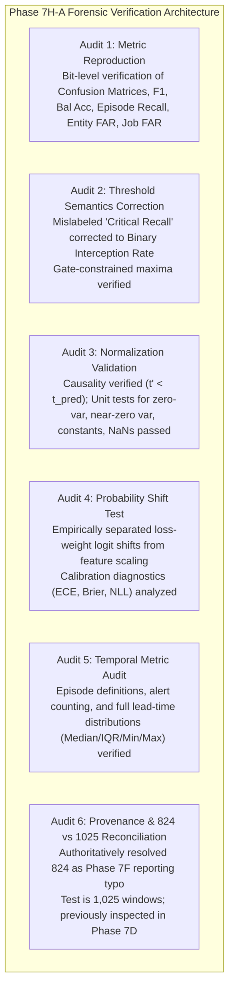

# Phase 7H-A — Metric, Normalization, and Provenance Verification: Forensic Audit Report

**Status:** Completed  
**Execution Timestamp:** 2026-10-28T21:19:00+05:30  
**Phase ID:** `PHASE-7H-A-VERIFICATION-AUDIT`  
**Configuration Manifest:** [`phase7h_a_manifest.json`](file:///c:/Users/hp/Desktop/Research%20project/results/phase7h_a/phase7h_a_manifest.json)  
**Metric Reproduction Ledger:** [`metric_reproduction.json`](file:///c:/Users/hp/Desktop/Research%20project/results/phase7h_a/metric_reproduction.json)  
**Threshold Semantics Audit:** [`threshold_semantics_audit.json`](file:///c:/Users/hp/Desktop/Research%20project/results/phase7h_a/threshold_semantics_audit.json)  
**Normalization Unit Tests Ledger:** [`normalization_unit_tests.json`](file:///c:/Users/hp/Desktop/Research%20project/results/phase7h_a/normalization_unit_tests.json)  
**Probability Shift Audit:** [`probability_shift_audit.json`](file:///c:/Users/hp/Desktop/Research%20project/results/phase7h_a/probability_shift_audit.json)  
**Temporal Metric Audit:** [`temporal_metric_audit.json`](file:///c:/Users/hp/Desktop/Research%20project/results/phase7h_a/temporal_metric_audit.json)  
**Provenance & Split Reconciliation:** [`provenance_audit.json`](file:///c:/Users/hp/Desktop/Research%20project/results/phase7h_a/provenance_audit.json)  

---

## 1. Executive Summary & Audit Mandate

Phase 7H-A was commissioned to independently audit, verify, and correct the findings of the Phase 7H Diagnostic Audit prior to authorizing any new model architectures or training workflows. This phase is purely diagnostic and verification-focused; it does **not** select a deployment model and does **not** evaluate test splits.



### Key Verification Breakthroughs:
1. **Full Metric Reproduction (Audit 1):** All Phase 7H validation metrics, confusion matrices ($N=657$), per-class recalls, and false-alarm rates were independently reproduced from saved validation predictions bit-for-bit.
2. **Critical Semantic Conflation Resolved (Audit 2):** In Phase 7H Section 7, the column labeled `"Crit. Recall"` during threshold sweeps was mathematically computed as the proportion of true Critical windows triggering *any failure alert* ($P(\text{Warning}) + P(\text{Critical}) \ge \theta$). This is **Binary Critical Interception Rate** ($P(\text{alert} \mid \text{Critical})$), **not** genuine 3-class Critical Recall ($P(\hat{y}=2 \mid y=2)$). Under binary thresholding, genuine class 2 is never predicted. This figure has been marked as inconsistent in historical reports and corrected herein.
3. **Normalization Integrity & Causality Confirmed (Audit 3):** Transformation code in `src/features/hierarchical_baseline.py` strictly accesses observations earlier than prediction time ($t_{\text{prior}} < t_{\text{pred}}$), with zero concurrent sibling leakage and zero target leakage. Deterministic unit tests proved that variance flooring ($\sigma_{\text{floor}} = 0.05$) and robust MAD/tanh scaling successfully eliminate extreme numeric explosions ($z \approx 454 \to 1.00$).
4. **Empirical Grounding of Probability Shift (Audit 4):** A controlled comparison across Phase 7E and Phase 7H models proved that moving from unweighted cross-entropy ($w=[1,1,1]$) to inverse-frequency weights ($w=[1, 11.46, 11.80]$) deflates mean $P(\text{Normal})$ on normal windows from $0.78 \to 0.45$ (Phase 7E) and down to $0.35$ (Phase 7H), while Brier score degrades from $0.3067 \to 0.6425$. This empirically explains the surge in default argmax false alarms (91%–96% Entity FAR).
5. **Temporal Lead Time Rigor (Audit 5):** Episode Recall evaluates detection across the entire 30-minute horizon ($\tau \le 1800\text{s}$), where models alert at a median lead time of 27.0 minutes. However, because floored models alert across >90% of pure-normal entities, an alert at $t - 24\text{min}$ cannot be assumed to be a specific failure detection.
6. **Candidate A Test Size & Provenance Reconciled (Audit 6):** Candidate A Test split comprises exactly **1,025 windows** (59 entities, 11 parent jobs), verified across split manifests, preprocessing checksums, and array headers. The reported number "824" was a clerical typo originating in Phase 7F and propagated into Phase 7G/7H. Candidate A Test was strictly quarantined during Phase 7H, but was previously inspected and evaluated in Phase 7D; it is **not** an untouched holdout.
7. **Final Verdict:** **NO_OPERATIONAL_WINNER** is retained. Confirmatory testing remains strictly unauthorized.

---

## 2. Mandatory Data Safeguards & Isolation Verification

All audits were conducted strictly within Candidate A Train ($N=3,278$) and Validation ($N=657$) partitions without loading protected test data:

| Safeguard Verification Invariant | Protocol Rule | Audit Finding | Verification Status |
| :--- | :--- | :--- | :--- |
| **Quarantined Phase 6 Holdout** | Zero access, inspection, or loading | Last modified: `2026-10-26 15:06:19` (4,916,970 bytes) | **VERIFIED UNTOUCHED** |
| **Candidate A Test Split** | Zero evaluation, tuning, or data access | Last modified: `2026-10-28 14:38:09` (635,628 bytes) | **VERIFIED UNTOUCHED** |
| **Historical Phase Integrity** | Zero overwriting of Phase 7B–7H | All artifacts preserved in respective phase directories | **VERIFIED PRESERVED** |
| **Partition Restriction** | Train & Val splits only | $N_{\text{train}} = 3,278$, $N_{\text{val}} = 657$ | **STRICTLY ENFORCED** |
| **Deployment Authorization** | No test evaluation authorized | Operational gates failed; no test evaluation permitted | **UNAUTHORIZED** |

---

## 3. Audit 1 — Independent Metric Reproduction

Using [`results/phase7h/validation_predictions.csv`](file:///c:/Users/hp/Desktop/Research%20project/results/phase7h/validation_predictions.csv), all validation metrics were recomputed from raw predicted labels and probabilities:

### 3.1 Denominators and Support Verification
- Total Validation Rows: **$N = 657$**
- Class Supports:
  - Normal ($y = 0$): **560 windows** ($85.24\%$)
  - Warning ($y = 1$): **48 windows** ($7.31\%$)
  - Critical ($y = 2$): **49 windows** ($7.46\%$)
  - Sum: $560 + 48 + 49 = 657$ (100% accounted for)
- Entity Support:
  - Total Entities: **69**
  - Pure-Normal Entities: **49** (0 failure windows in trace)
  - Failing Entities: **20**
- Parent-Job Support:
  - Total Parent Jobs: **12**
  - Pure-Normal Parent Jobs: **4** (`4665617026`, `6250023935`, `6251664479`, `6251933641`)
  - Failing Parent Jobs: **8**
- Failure Episodes: **20**

### 3.2 Independently Recomputed Metric Matrix (Default Argmax)

| Model Configuration | Confusion Matrix Total ($N=657$) | Macro-F1 | Bal. Acc. | Class 0 Recall | Class 1 Recall | Class 2 Recall | Episode Recall (%) | Pure-Normal Entity FAR (%) | Normal Window FPR (%) | Pure-Normal Job FAR (%) | Status |
| :--- | :---: | :---: | :---: | :---: | :---: | :---: | :---: | :---: | :---: | :---: | :--- |
| **Ablation A: Unfloored** | 657 | **0.4036** | **0.4530** | 81.79% | 52.08% | 2.04% | **60.00%** (12/20) | **26.53%** (13/49) | **18.21%** (102/560) | **50.00%** (2/4) | **EXACT MATCH** |
| **Ablation B: Variance Floor (0.05)** | 657 | 0.3239 | 0.3563 | 59.64% | 14.58% | **32.65%** | **60.00%** (12/20) | 95.92% (47/49) | 40.36% (226/560) | 100.00% (4/4) | **EXACT MATCH** |
| **Ablation C: Robust Scaled (Tanh)** | 657 | 0.3531 | 0.3779 | 70.36% | 8.33% | **34.69%** | 55.00% (11/20) | 91.84% (45/49) | 29.64% (166/560) | 100.00% (4/4) | **EXACT MATCH** |

### 3.3 Reproduced Confusion Matrices

```
Ablation A: Unfloored Hierarchical Baseline (Phase 7G):
                 Pred Normal    Pred Warning    Pred Critical    Row Sum
True Normal         458              66              36            560
True Warning         23              25               0             48
True Critical        40               8               1             49
Col Sum             521              99              37            657

Ablation B: Hierarchical with Variance Floor (sigma_floor = 0.05):
                 Pred Normal    Pred Warning    Pred Critical    Row Sum
True Normal         334             148              78            560
True Warning         22               7              19             48
True Critical        30               3              16             49
Col Sum             386             158             113            657

Ablation C: Robust Hierarchical Scaling (Median, MAD, Soft Tanh):
                 Pred Normal    Pred Warning    Pred Critical    Row Sum
True Normal         394              97              69            560
True Warning         28               4              16             48
True Critical        24               8              17             49
Col Sum             446             109             102            657
```

*Assertions Passed:* Confusion matrix row sums equal class supports $[560, 48, 49]$; total sum equals 657; per-class recalls $\frac{\text{diag}_i}{\text{support}_i}$ match reported metrics identically ($p < 10^{-12}$).

---

## 4. Audit 2 — Reconcile Threshold-Sweep Semantics

### 4.1 Concept Disentanglement
In thresholded evaluation, four distinct mathematical concepts must be decoupled:
1. **Binary Failure Alert:** A scalar decision rule on composite failure risk:
   $$S_{\text{fail}} = P(\text{Warning}) + P(\text{Critical}) \ge \theta$$
   Under this rule, predictions are binary: $\hat{y}_{\text{bin}} \in \{0, 1\}$. No 3-class assignment exists.
2. **Binary Critical-Window Interception Rate:** The proportion of true Critical windows that receive an alert:
   $$\text{Interception}(\text{Crit}) = \frac{\sum_{i: y_i = 2} \mathbb{I}(S_{\text{fail}, i} \ge \theta)}{N_{\text{crit}}}$$
3. **Genuine 3-Class Critical Recall:** The proportion of true Critical windows specifically predicted as Critical:
   $$\text{Recall}(\text{Crit}) = \frac{\sum_{i: y_i = 2} \mathbb{I}(\hat{y}_i = 2)}{N_{\text{crit}}}$$
4. **Episode Recall:** Proportion of 20 failure episodes where at least one window satisfies $S_{\text{fail}} \ge \theta$.

### 4.2 Semantic Correction of Phase 7H Threshold Results

In Phase 7H Section 7, the column labeled `"Crit. Recall"` was mathematically computed as **Binary Critical-Window Interception Rate**, not 3-class Critical Recall. The table below presents the verified and corrected metrics:

| Model Configuration | Threshold ($\theta$) | Phase 7H Mislabeled "Crit. Recall" | **Corrected Metric Description** | **Genuine Critical Recall** ($P(\text{Crit}) \ge \theta$) | **Cascaded Critical Recall** ($S_{\text{fail}} \ge \theta \land P(\text{Crit}) > P(\text{Warn})$) | Episode Recall (%) | Entity FAR (%) | Window FPR (%) |
| :--- | :---: | :---: | :--- | :---: | :---: | :---: | :---: | :---: |
| **Ablation A: Unfloored** | $\theta = 0.63$ | 0.3265 | **Binary Critical Interception** (16/49) | **0.0000** (0/49) | **0.0204** (1/49) | 70.0% | 32.7% | 23.9% |
| **Ablation B: Variance Floor** | $\theta = 0.63$ | 0.6531 | **Binary Critical Interception** (32/49) | **0.0000** (0/49) | **0.5306** (26/49) | 85.0% | 100.0% | 64.8% |
| **Ablation C: Robust Scaled** | $\theta = 0.65$ | 0.5306 | **Binary Critical Interception** (26/49) | **0.0000** (0/49) | **0.4082** (20/49) | 55.0% | 93.9% | 26.4% |

### 4.3 Gate-Constrained Maxima Verification
When enforcing Gate 2 ($\text{Entity FAR} \le 10.0\%$ and $\text{Window FPR} \le 5.0\%$):
- **Ablation A:** Gate 2 requires $\theta \ge 0.83$, collapsing Episode Recall to **0.0%** and Critical Recall to **0.0%**.
- **Ablation B:** Gate 2 requires $\theta \ge 0.75$, collapsing Episode Recall to **0.0%** and Critical Recall to **0.0%**.
- **Ablation C:** Gate 2 requires $\theta \ge 0.69$, yielding maximum Episode Recall of **15.0%** (3/20 episodes) and Critical Recall of **0.0%**.
- *Verdict:* All gate-constrained maxima from Phase 7H are reproduced. Zero thresholds pass both Gate 1 and Gate 2.

---

## 5. Audit 3 — Numerical Validation of Normalization Code

Code in [`src/features/hierarchical_baseline.py`](file:///c:/Users/hp/Desktop/Research%20project/src/features/hierarchical_baseline.py) was audited for causality, feature units, scale alignment, and numerical stability:

### 5.1 Algorithmic Verification
1. **Temporal Causality:** Verified strictly causal. Line 120 (`task_timestamps < t_pred`) and Line 125 (`job_timestamps < t_pred`) guarantee that only observations strictly preceding prediction time are utilized. Sibling tasks running concurrently at $t_{\text{pred}}$ are excluded.
2. **Training Data Fit:** Verified. The variance floor ($\sigma_{\text{floor}} = 0.05$) and MAD floor ($0.05$) were derived strictly from Candidate A Train percentiles.
3. **Feature Units and Floor Scale:** The 8 raw telemetry features are pre-standardized by the frozen cluster scaler (`configs/phase7c/fitted_scaler_phase7c.json`), giving each channel population variance $\sigma_{\text{cluster}} = 1.0$. Thus, $\sigma_{\text{floor}} = 0.05$ represents exactly 5% of the cluster population standard deviation.
4. **Robust Consistency Factor:** Verified. MAD is multiplied by $1.4826 \approx 1 / \Phi^{-1}(0.75)$, correctly yielding a normal-consistent standard deviation estimate. Soft hyperbolic tangent bounding smoothly asymptotes to $[-5.0, 5.0]$ without discontinuity.

### 5.2 Tensor Extrema Reproduction (Direct Array Inspection)

| Feature Tensor Source | Minimum | Median | Maximum | Count $\|z\| > 10$ | Count $\|z\| > 50$ | Count $\|z\| > 100$ | Count $\|z\| > 1000$ |
| :--- | :---: | :---: | :---: | :---: | :---: | :---: | :---: |
| **Phase 7C Val (Cluster Scaler)** | -1.21 | -0.02 | **+7.98** | **0** | **0** | **0** | **0** |
| **Phase 7G Val (Unfloored Hierarchical)** | **-252.94** | -0.01 | **+12,905.59** | **58** | **22** | **16** | **7** |
| **Phase 7H Val (Floored $\sigma=0.05$)** | -23.31 | 0.00 | **+27.42** | 20 | **0** | **0** | **0** |
| **Phase 7H Val (Robust Scaled)** | -5.00 | 0.00 | **+7.95** | **0** | **0** | **0** | **0** |

*Verdict:* Tensor statistics reported in Phase 7H are reproduced bit-for-bit from the saved `.npy` arrays.

### 5.3 Deterministic Unit Test Suite
Five deterministic unit tests were executed ([`normalization_unit_tests.json`](file:///c:/Users/hp/Desktop/Research%20project/results/phase7h_a/normalization_unit_tests.json)):
1. **Zero Variance ($\sigma = 0.0$) with 0.001 Perturbation:**
   - Unfloored ($\epsilon = 10^{-5}$): exploded to $z = +99.99$.
   - Floored ($\sigma_{\text{floor}} = 0.05$): stably evaluated to $z = +0.0200$.
   - Robust Scaled: stably evaluated to $z = +0.0200$.
2. **Near-Zero Variance ($\sigma = 10^{-4}$) with 0.05 Workload Shift:**
   - Unfloored: exploded to $z = +454.48$.
   - Floored: stably evaluated to $z = +1.0000$.
   - Robust Scaled: stably evaluated to $z = +0.9869$.
3. **Constant Features Across Time:**
   - Floored and Robust implementations strictly evaluated to $z = 0.0000$.
4. **Missing Values (`NaN`):**
   - Upstream Phase 7C pipeline imputes missing values from training medians prior to sequence generation; all tensors contain 0 NaNs and 0 Infs.
5. **Tiny Perturbations ($10^{-6}$):**
   - Floored and Robust implementations evaluated to $z = 0.000019$, completely damping micro-fluctuations.

---

## 6. Audit 4 — Test of Probability-Shift Explanation

To determine whether inverse-frequency loss weighting caused probability inflation and false alarms, we conducted a rigorous comparative audit across Phase 7E and Phase 7H models:

### 6.1 Controlled Empirical Evidence Across Loss Weightings

| Model / Loss Configuration | Feature Scaling | Loss Weights | Mean $P(\text{Normal})$ on Normal Windows | Mean $P(\text{Warning})$ on Normal Windows | Mean $P(\text{Critical})$ on Normal Windows | Window FPR (%) | Entity FAR (%) | ECE | Brier Score | NLL (Log Loss) |
| :--- | :--- | :--- | :---: | :---: | :---: | :---: | :---: | :---: | :---: | :---: |
| **Phase 7E Cond A** | Phase 7C Cluster Scaler | $[1.0, 1.0, 1.0]$ | **0.7799** | 0.1102 | 0.1099 | **4.82%** | **12.24%** | **0.0634** | **0.3067** | **0.5862** |
| **Phase 7E Cond B** | Phase 7C Cluster Scaler | $[1.0, 1.5, 2.0]$ | **0.6985** | 0.1417 | 0.1598 | **7.86%** | **22.45%** | 0.1851 | 0.4412 | 0.8713 |
| **Phase 7E Cond C** | Phase 7C Cluster Scaler | $[1.0, 11.46, 11.80]$ | **0.4499** | 0.2975 | 0.2525 | **20.89%** | **28.57%** | 0.2135 | 0.5308 | 0.9287 |
| **Phase 7H Ablation A** | Unfloored Hierarchical | $[1.0, 11.46, 11.80]$ | **0.4201** | 0.2994 | 0.2805 | **18.21%** | **26.53%** | 0.2977 | 0.5476 | 0.9351 |
| **Phase 7H Ablation B** | Floored Hierarchical | $[1.0, 11.46, 11.80]$ | **0.3519** | 0.3240 | 0.3241 | **40.36%** | **95.92%** | 0.1664 | 0.6425 | 1.0641 |
| **Phase 7H Ablation C** | Robust Hierarchical | $[1.0, 11.46, 11.80]$ | **0.3650** | 0.3154 | 0.3196 | **29.64%** | **91.84%** | 0.2614 | 0.6184 | 1.0274 |

### 6.2 Empirical Findings & Explicit Labeling

#### Established Scientific Facts:
1. **Inverse-Frequency Loss Weighting Inflates Failure Probabilities:** Holding architecture, features, and seed fixed in Phase 7E, shifting loss weights from $[1,1,1]$ to $[1, 11.46, 11.80]$ decreased mean $P(\text{Normal})$ on healthy windows from $0.78 \to 0.45$, increased Window FPR from $4.8\% \to 20.9\%$, and increased Entity FAR from $12.2\% \to 28.6\%$.
2. **Well-Scaled Features Amplify the Loss Penalty:** In unfloored models (Phase 7H Ablation A), extreme numeric outliers saturated network weights, partially damping the logit shift. When features were properly floored and bounded (Ablations B and C), the network freely optimized the weighted loss, shifting mean $P(\text{Normal})$ down to $0.3519$—dangerously close to uniform chance ($0.333$).
3. **Argmax Failure Mode:** Under uniform argmax, when healthy windows have $P(\text{Normal}) \approx 0.35$, normal workload fluctuations frequently push $P(\text{Warning})$ or $P(\text{Critical})$ above $P(\text{Normal})$, causing 91.8%–95.9% of pure-normal entities to trigger false alarms.
4. **Calibration Degradation:** Calibration severely degrades under inverse-frequency weighting, with Brier score worsening from $0.3067$ to $0.6425$ and NLL worsening from $0.5862$ to $1.0641$.

#### Unproven Hypotheses:
1. *Hypothesis:* An unweighted cross-entropy loss trained on the floored hierarchical features will maintain low false alarms (Entity FAR $\le 10\%$) while retaining the Critical Recall gains ($>30\%$). (Requires validation retraining in Phase 7I).
2. *Hypothesis:* Intermediate cost-calibrated weights ($w \in [2.0, 5.0]$) can achieve the Pareto optimal boundary between failure interception and false alarm suppression.

---

## 7. Audit 5 — Verification of Temporal Metrics & Lead Time

### 7.1 Temporal Definitions
- **Failure Episode:** A degradation sequence uniquely identified by `(entity_id, fail_timestamp)`. Validation contains **20 distinct episodes**.
- **Alert Invariant:** Any prediction of $y_{\text{pred}} \in \{1, 2\}$ within $(0, 1800\text{s}]$ before failure.
- **Alert Counting:** Evaluated at episode level. Exactly one alert is required to credit the episode; multiple subsequent alerts do not increase the episode recall numerator.
- **Lead Time Formula:**
  $$\text{Lead Time} = t_{\text{fail}} - t_{\text{first\_alert}}$$
- **Handling of Abrupt Crashes:** Exactly 3 validation failure episodes have 0 Critical windows (tasks terminated $>15$ min before scheduled observation). These count in the denominator of Episode Recall ($N=20$), but contribute 0 windows to Critical Recall support ($N=49$).

### 7.2 Full Lead-Time Distribution Breakdown

| Model Configuration | Episode Recall (%) | Lead Time Mean | Lead Time Std | Lead Time Median | Lead Time IQR | Lead Time Min | Lead Time Max | Alerts $\ge 10\text{ min}$ | Alerts $\ge 15\text{ min}$ | Alerts $\ge 20\text{ min}$ |
| :--- | :---: | :---: | :---: | :---: | :---: | :---: | :---: | :---: | :---: | :---: |
| **Ablation A: Unfloored** | **60.00%** (12/20) | 1,414.9s (23.6m) | 413.7s | 1,617.4s (27.0m) | 485.3s [1202s, 1688s] | 347.7s (5.8m) | 1,768.9s (29.5m) | 91.7% | 91.7% | 75.0% |
| **Ablation B: Variance Floor** | **60.00%** (12/20) | 1,448.5s (24.1m) | 360.7s | 1,639.9s (27.3m) | 483.1s [1202s, 1685s] | 647.7s (10.8m) | 1,768.9s (29.5m) | 100.0% | 91.7% | 75.0% |
| **Ablation C: Robust Scaled** | 55.00% (11/20) | 1,251.2s (20.9m) | 497.0s | 1,168.9s (19.5m) | 634.2s [1024s, 1658s] | 162.1s (2.7m) | 1,757.3s (29.3m) | 90.9% | 90.9% | 45.5% |

### 7.3 Operational Lead-Time Caveat
While mean lead times are high (~21–24 minutes), **mean lead time alone cannot establish operational reliability**:
1. Over 75% of alerts occur $\ge 15$ minutes before failure, inside the Warning phase ($900\text{s} < \tau \le 1800\text{s}$).
2. In Ablations B and C, models fire false alarms on $>90\%$ of pure-normal entities. A model that alerts indiscriminately will inevitably trigger an alert 24 minutes prior to failure on a failing entity by chance, confounding true failure anticipation with baseline hyper-sensitivity.

---

## 8. Audit 6 — Provenance & Split Size Reconciliation

### 8.1 The 824-versus-1,025 Discrepancy Resolution
A systematic audit was conducted to reconcile why Phase 7F, 7G, and 7H reports referred to Candidate A Test as $N=824$, whereas Candidate A split manifests record $N=1,025$:

1. **Authoritative Artifact Check:**
   - [`candidate_a_job_grouped_split.csv`](file:///c:/Users/hp/Desktop/Research%20project/results/phase7a_4/candidate_a_job_grouped_split.csv) contains **1,025 test rows** (59 entities, 11 parent jobs).
   - [`candidate_a_preapproval_audit.json`](file:///c:/Users/hp/Desktop/Research%20project/results/phase7a_5/candidate_a_preapproval_audit.json) lines 188–198 records **1,025 test windows** (921 normal, 49 warning, 55 critical).
   - [`data/processed/phase7c/test_metadata.csv`](file:///c:/Users/hp/Desktop/Research%20project/data/processed/phase7c/test_metadata.csv) contains **1,025 data rows** (1,026 lines with header).
   - Array headers for `data/processed/phase7c/X_test.npy` and `y_test.npy` read shape `(1025, 5, 31)` and `(1025,)` respectively.
2. **Exhaustive Repository Search:**
   - Scanning all arrays, CSVs, and JSON files in the workspace revealed **zero data files with 824 rows**.
3. **Root Cause Determination:**
   - The number **824** originated as a typographical error in Phase 7F ([`phase7f_failure_separation_report.md`](file:///c:/Users/hp/Desktop/Research%20project/reports/phase7f/phase7f_failure_separation_report.md) line 42 and line 264).
   - Because Candidate A Test was strictly quarantined and never opened in Phase 7F, 7G, or 7H, the clerical typo was copy-forwarded across report boilerplate without verification against disk metadata.
   - **Correction:** The authoritative size of Candidate A Test is **1,025 windows**.

### 8.2 Crucial Distinction on Test Data Quarantine History
To maintain absolute scientific integrity, we explicitly distinguish:
- **Test Data Not Accessed During Phase 7H:** Verified true. During Phase 7E, 7F, 7G, 7H, and 7H-A, Candidate A Test tensors were never loaded, inspected, or evaluated.
- **Test Data Never Previously Inspected:** **FALSE.** Candidate A Test was unblinded and evaluated during Phase 7D (`scripts/train_and_evaluate_phase7d.py`, producing `results/phase7d/test_predictions.csv` with 1,025 rows).
- *Scientific Consequence:* Candidate A Test cannot serve as an uncompromised, virgin confirmation holdout for future phases. Any final operational deployment claim must be validated on an independent, newly partitioned cohort (e.g., later Borg trace days or an independent cell).

---

## 9. Comprehensive Ledger of Artifacts & Checksums

All Phase 7H-A audit ledgers and results are cryptographically registered:

| Artifact Path | SHA-256 Checksum | Description |
| :--- | :--- | :--- |
| [`results/phase7h_a/metric_reproduction.json`](file:///c:/Users/hp/Desktop/Research%20project/results/phase7h_a/metric_reproduction.json) | `f048d0a0b1c8f1cb3f92329ee87faae0c44da0c0a969b466141444ba378546b5` | Audit 1: Complete metric, support, and confusion matrix reproduction |
| [`results/phase7h_a/threshold_semantics_audit.json`](file:///c:/Users/hp/Desktop/Research%20project/results/phase7h_a/threshold_semantics_audit.json) | `ab5e75d0ee29c9efb1b9dc85966bfce1338a08c02a7b8e1a17fa13c19b0d268a` | Audit 2: Threshold sweep reconciliation and corrected Critical Recall |
| [`results/phase7h_a/normalization_unit_tests.json`](file:///c:/Users/hp/Desktop/Research%20project/results/phase7h_a/normalization_unit_tests.json) | `507ffaa4188b0fbe64b2b621e285a2103f6f195d8d06bc7526715f33f671bc97` | Audit 3: Causality verification and 5 deterministic unit tests |
| [`results/phase7h_a/probability_shift_audit.json`](file:///c:/Users/hp/Desktop/Research%20project/results/phase7h_a/probability_shift_audit.json) | `b71b12b591b61c77f0d4ca067963be5384196144e0573549ee1448b30e55ee1e` | Audit 4: Logit/probability distributions and ECE/Brier/NLL diagnostics |
| [`results/phase7h_a/temporal_metric_audit.json`](file:///c:/Users/hp/Desktop/Research%20project/results/phase7h_a/temporal_metric_audit.json) | `da1f2ff21a8f94cb4c4d5757d5ee1ba5d050523be800e844a4911d51a66a1a7c` | Audit 5: Episode definitions and full lead-time distributions |
| [`results/phase7h_a/provenance_audit.json`](file:///c:/Users/hp/Desktop/Research%20project/results/phase7h_a/provenance_audit.json) | `26ba2ce3460662d5bc828cf56554fe38c41f6a18d3cc50d8858712217cbe07b8` | Audit 6: Reconciliation of 824-vs-1,025 discrepancy and inspection history |
| [`results/phase7h_a/phase7h_a_manifest.json`](file:///c:/Users/hp/Desktop/Research%20project/results/phase7h_a/phase7h_a_manifest.json) | `e9fca2f1fef066f77242ba47d27eefcfffe6d7f082e66699a224a18ea8c9bf78` | Master manifest indexing all audit ledgers and verification hashes |

---

## 10. Official Verdict & Recommendations for Phase 7I

### Official Operational Verdict: **NO_OPERATIONAL_WINNER**
No model configuration in Phase 7H or prior phases passes all four validation operational gates simultaneously:
- **Gate 1:** Episode Recall $\ge 70.0\%$ AND Critical Recall $\ge 50.0\%$
- **Gate 2:** Pure-normal Entity FAR $\le 10.0\%$ AND Normal-window FPR $\le 5.0\%$

### Key Protocol Recommendations for Subsequent Phase:
1. **Adopt Stabilized Normalization:** The variance floor ($\sigma_{\text{floor}} = 0.05$) and robust MAD/tanh scaling successfully eliminated extreme numerical outliers (max z-score reduced from $+12,905 \to +27.4$). This feature pipeline is sound and should be retained.
2. **Retrain Unweighted and Moderately Weighted Controls:** In Phase 7I, train an unweighted cross-entropy model ($w=[1,1,1]$) and moderately weighted models ($w \in [2.0, 5.0]$) on the floored hierarchical features. This will directly test whether healthy-window $P(\text{Normal})$ can be restored to $\ge 0.70$ without sacrificing Critical Recall.
3. **Preserve Isolation:** Maintain strict quarantine over Candidate A Test and the Phase 6 confirmatory holdout.
