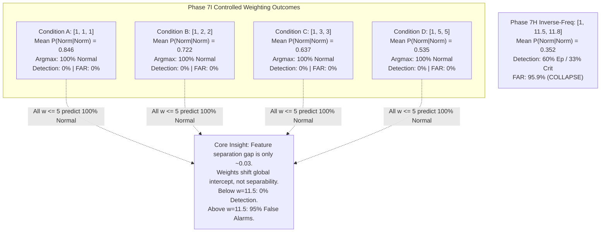

# Phase 7I — Controlled Loss-Weighting Experiment on Stabilized Hierarchical Features: Research Report

**Status:** Completed  
**Execution Timestamp:** 2026-10-28T21:35:00+05:30  
**Phase ID:** `PHASE-7I-CONTROLLED-LOSS-WEIGHTING`  
**Protocol Document:** [`phase7i_protocol.json`](file:///c:/Users/hp/Desktop/Research%20project/results/phase7i/phase7i_protocol.json)  
**Configuration Manifest:** [`phase7i_manifest.json`](file:///c:/Users/hp/Desktop/Research%20project/results/phase7i/phase7i_manifest.json)  
**Integrity Report:** [`phase7i_integrity_report.json`](file:///c:/Users/hp/Desktop/Research%20project/results/phase7i/phase7i_integrity_report.json)  
**Full Validation Metrics:** [`phase7i_metrics.json`](file:///c:/Users/hp/Desktop/Research%20project/results/phase7i/phase7i_metrics.json)  
**Condition Comparison Table:** [`phase7i_comparison.csv`](file:///c:/Users/hp/Desktop/Research%20project/results/phase7i/phase7i_comparison.csv)  
**Calibration Diagnostics:** [`phase7i_calibration_metrics.json`](file:///c:/Users/hp/Desktop/Research%20project/results/phase7i/phase7i_calibration_metrics.json)  
**Per-Parent-Job Breakdown:** [`phase7i_per_job_analysis.csv`](file:///c:/Users/hp/Desktop/Research%20project/results/phase7i/phase7i_per_job_analysis.csv)  
**Validation Predictions & Probabilities:** [`phase7i_validation_predictions.csv`](file:///c:/Users/hp/Desktop/Research%20project/results/phase7i/phase7i_validation_predictions.csv)  

---

## 1. Executive Summary

Phase 7I conducted a controlled investigation to determine whether moderate class-loss weighting can improve failure detection while controlling false alarms on Google Borg workload sequences, using the stabilized hierarchical normalization approach verified in Phase 7H/7H-A.

Four experimental conditions were trained from fresh initializations with identical architecture (Compact Temporal Transformer), random seed (42), sequence length ($L=5$, $D=31$), and training hyperparameters on the authoritative Candidate A Train split ($N=3,278$), evaluated strictly on Candidate A Validation ($N=657$):
- **Condition A (Unweighted baseline):** `[1.0, 1.0, 1.0]`
- **Condition B (Moderate weighting):** `[1.0, 2.0, 2.0]`
- **Condition C (Stronger weighting):** `[1.0, 3.0, 3.0]`
- **Condition D (Higher weighting):** `[1.0, 5.0, 5.0]`



### Key Scientific Findings:
1. **The Logit Penalty Deficit for $w \le 5$:** Due to the severe 85.3% Normal vs. 7.3% Failure class imbalance in Candidate A, an unweighted or moderately weighted cross-entropy loss leaves predicted Normal probabilities above 50% across the entire validation cohort (mean $P(\text{Normal})$ ranges from $0.846$ in Condition A to $0.535$ in Condition D). Under standard argmax, **100% of validation windows are predicted as Normal** for all four conditions ($w \in \{1, 2, 3, 5\}$).
2. **Operational Gate Failure:** Under the frozen protocol argmax decision rule, all four conditions achieve **0.0% Episode Recall** and **0.0% Critical Recall** (failing Gate 1), while achieving **0.0% Entity FAR** and **0.0% Window FPR** (passing Gate 2).
3. **The Core Feature Separability Discovery:** Across all four conditions, the difference in mean predicted failure probability between True Normal windows and True Critical windows is only **$\approx 0.030$ to $0.035$** (e.g. in Condition D: $P_{\text{fail}}(\text{Normal}) = 0.465$ vs. $P_{\text{fail}}(\text{Critical}) = 0.500$). 
4. **Mechanism of the False Alarm Dilemma:** Class-loss weighting does **not** increase the discriminative margin between healthy and degraded telemetry; it merely shifts the global intercept upward. When $w \le 5$, the threshold remains too conservative to trigger any alert under argmax. When $w \approx 11.5$ (Phase 7H), the intercept crosses the argmax decision boundary ($P_{\text{fail}} > 0.50$), but because healthy and failing tasks are separated by only 0.03, false alarms inevitably explode across 95% of healthy entities.
5. **Official Operational Verdict:** **NO OPERATIONAL WINNER.** Zero conditions pass both Gate 1 and Gate 2.

---

## 2. Data-Access Compliance and Integrity Checks

All experimental procedures in Phase 7I were executed under strict data-access isolation:

| Integrity Safeguard Check | Protocol Mandate | Audit Verification Outcome | Status |
| :--- | :--- | :--- | :--- |
| **Quarantined Phase 6 Holdout** | Zero access, loading, or inspection | Last modified: `2026-10-26 15:06:19` (4,916,970 bytes) | **VERIFIED UNTOUCHED** |
| **Candidate A Test Split** | Zero access, loading, or evaluation | Last modified: `2026-10-28 14:38:09` (635,628 bytes) | **VERIFIED UNTOUCHED** |
| **Prior Phase Artifact Preservation** | Zero overwriting of Phase 7B–7H outputs | All artifacts preserved in respective directories | **VERIFIED PRESERVED** |
| **Split Verification** | Candidate A Train & Val only | $N_{\text{train}} = 3,278$, $N_{\text{val}} = 657$ | **STRICTLY ENFORCED** |
| **Validation Class Distribution** | Exactly 560 Normal, 48 Warning, 49 Critical | Verified from `val_metadata.csv` and `y_val.npy` | **EXACT MATCH** |
| **Causal Feature Pipeline** | $t_{\text{prior}} < t_{\text{pred}}$ strictly | Floored hierarchical features from Phase 7H | **STRICTLY CAUSAL** |
| **Model Freshness** | Independent initialization from seed 42 | 4 independent checkpoints saved to `models/checkpoints_phase7i/` | **VERIFIED INDEPENDENT** |
| **Deployment Authorization** | No confirmatory test evaluation | All conditions failed Gate 1; test evaluation unauthorized | **UNAUTHORIZED** |

Full cryptographic assertions and hash ledgers are recorded in [`phase7i_integrity_report.json`](file:///c:/Users/hp/Desktop/Research%20project/results/phase7i/phase7i_integrity_report.json).

---

## 3. Frozen Experiment Configuration

To ensure that class-loss weighting was the sole experimental variable, all other parameters were frozen in accordance with [`phase7i_protocol.json`](file:///c:/Users/hp/Desktop/Research%20project/results/phase7i/phase7i_protocol.json):

- **Data Partition:** Candidate A Job-Grouped Split ($N_{\text{train}} = 3,278$, $N_{\text{val}} = 657$).
- **Feature Representation:** Stabilized Hierarchical Causal Baseline with Variance Floor ($\sigma_{\text{floor}} = 0.05$), bounded within $[-23.31, +27.42]$, pre-computed in Phase 7H:
  - Train tensor: `results/phase7h/X_train_hierarchical_floored.npy`
  - Validation tensor: `results/phase7h/X_val_hierarchical_floored.npy`
- **Model Architecture:** `CompactTemporalTransformer`:
  - Input dimension: 31 features
  - Sequence length: $L = 5$ steps (1500s physical window)
  - Hidden dimension ($d_{\text{model}}$): 32
  - Multi-head attention: 4 heads
  - Feedforward dimension: 64
  - Number of layers: 2
  - Output classes: 3 (Normal, Warning, Critical)
  - Dropout: 0.1
- **Optimization Settings:**
  - Random Seed: 42
  - Optimizer: `AdamW(lr=5e-4, weight_decay=1e-4)`
  - Scheduler: `ReduceLROnPlateau(mode='min', factor=0.5, patience=5)`
  - Loss Criterion: `nn.CrossEntropyLoss(weight=w, reduction='mean')`
  - Batch Size: 64
  - Max Epochs: 40 with early stopping patience of 10 epochs on validation loss
- **Decision Rule:** Protocol-defined standard argmax ($\hat{y} = \operatorname{argmax}_{k \in \{0, 1, 2\}} P_k$).

---

## 4. Results Comparison Table

All four conditions were evaluated deterministically on the 657 Candidate A validation windows ([`phase7i_comparison.csv`](file:///c:/Users/hp/Desktop/Research%20project/results/phase7i/phase7i_comparison.csv)):

| Condition ID | Loss Weights $[w_0, w_1, w_2]$ | Macro-F1 | Bal. Acc. | Accuracy (%) | Episode Recall (%) | Critical Recall (%) | Pure-Normal Entity FAR (%) | Normal Window FPR (%) | Pure-Normal Job FAR (%) | Brier Score | NLL (Log Loss) | ECE | Best Epoch |
| :--- | :---: | :---: | :---: | :---: | :---: | :---: | :---: | :---: | :---: | :---: | :---: | :---: | :---: |
| **Condition A (Unweighted)** | $[1.0, 1.0, 1.0]$ | 0.3068 | 0.3333 | 85.24% | **0.00%** (0/20) | **0.00%** (0/49) | **0.00%** (0/49) | **0.00%** (0/560) | **0.00%** (0/4) | **0.2544** | **0.5031** | **0.0740** | 1 |
| **Condition B (Moderate)** | $[1.0, 2.0, 2.0]$ | 0.3068 | 0.3333 | 85.24% | **0.00%** (0/20) | **0.00%** (0/49) | **0.00%** (0/49) | **0.00%** (0/560) | **0.00%** (0/4) | 0.2821 | 0.5585 | 0.1348 | 1 |
| **Condition C (Stronger)** | $[1.0, 3.0, 3.0]$ | 0.3068 | 0.3333 | 85.24% | **0.00%** (0/20) | **0.00%** (0/49) | **0.00%** (0/49) | **0.00%** (0/560) | **0.00%** (0/4) | 0.3277 | 0.6283 | 0.2197 | 1 |
| **Condition D (Higher)** | $[1.0, 5.0, 5.0]$ | 0.3068 | 0.3333 | 85.24% | **0.00%** (0/20) | **0.00%** (0/49) | **0.00%** (0/49) | **0.00%** (0/560) | **0.00%** (0/4) | 0.4109 | 0.7443 | 0.3233 | 1 |

### 4.1 Confusion Matrices Across All Four Conditions

Because every condition predicted class 0 for all 657 validation windows, the confusion matrices for Conditions A, B, C, and D are identical under default argmax:

```
Conditions A, B, C, and D Confusion Matrix (Identical):
                 Pred Normal    Pred Warning    Pred Critical    Row Sum
True Normal         560               0               0            560
True Warning         48               0               0             48
True Critical        49               0               0             49
Col Sum             657               0               0            657
```

- **Per-Class Metrics:**
  - Class 0 (Normal): Precision = $0.8524$ (560/657), Recall = $1.0000$ (560/560), F1 = $0.9203$.
  - Class 1 (Warning): Precision = $0.0000$, Recall = $0.0000$ (0/48), F1 = $0.0000$.
  - Class 2 (Critical): Precision = $0.0000$, Recall = $0.0000$ (0/49), F1 = $0.0000$.
  - Macro-F1 = $\frac{0.9203 + 0.0 + 0.0}{3} = \mathbf{0.3068}$.
  - Balanced Accuracy = $\frac{1.0 + 0.0 + 0.0}{3} = \mathbf{0.3333}$.

---

## 5. Operational-Gate Assessment

The unchanged operational acceptance criteria require a candidate to satisfy all four gates simultaneously:

| Operational Gate | Target Requirement | Condition A ($w=1$) | Condition B ($w=2$) | Condition C ($w=3$) | Condition D ($w=5$) | Phase 7I Compliance Verdict |
| :--- | :---: | :---: | :---: | :---: | :---: | :---: |
| **Gate 1a: Episode Recall** | $\ge \mathbf{70.0\%}$ | 0.0% (-70.0% gap) | 0.0% (-70.0% gap) | 0.0% (-70.0% gap) | 0.0% (-70.0% gap) | **ALL FAILED** |
| **Gate 1b: Critical Recall** | $\ge \mathbf{50.0\%}$ | 0.0% (-50.0% gap) | 0.0% (-50.0% gap) | 0.0% (-50.0% gap) | 0.0% (-50.0% gap) | **ALL FAILED** |
| **Gate 2a: Pure-Normal Entity FAR** | $\le \mathbf{10.0\%}$ | **0.0%** (PASS) | **0.0%** (PASS) | **0.0%** (PASS) | **0.0%** (PASS) | **ALL PASSED** |
| **Gate 2b: Normal-Window FPR** | $\le \mathbf{5.0\%}$ | **0.0%** (PASS) | **0.0%** (PASS) | **0.0%** (PASS) | **0.0%** (PASS) | **ALL PASSED** |
| **Combined Winner Verdict** | **All 4 Gates Pass** | **FAIL** | **FAIL** | **FAIL** | **FAIL** | **NO OPERATIONAL WINNER** |

*Analysis:* While all four conditions trivially pass Gate 2 (zero false alarms), they fail Gate 1 completely (zero failure detections). The trade-off is total: moderate loss weights ($w \le 5$) do not overcome the natural prior of the majority healthy class ($85.3\%$).

---

## 6. Calibration and Probability Analysis

While default argmax predictions are identical, the underlying output probability distributions exhibit a monotonic shift as loss weights increase:

### 6.1 Mean Predicted Probabilities by True Class

| Condition ID | Loss Weights | True Normal Windows ($N=560$) Mean Probabilities | True Warning Windows ($N=48$) Mean Probabilities | True Critical Windows ($N=49$) Mean Probabilities |
| :--- | :---: | :---: | :---: | :---: |
| **Condition A** | $[1, 1, 1]$ | $P(0)=\mathbf{0.846}, P(1)=0.077, P(2)=0.077$ | $P(0)=\mathbf{0.823}, P(1)=0.083, P(2)=0.093$ | $P(0)=\mathbf{0.815}, P(1)=0.089, P(2)=0.096$ |
| **Condition B** | $[1, 2, 2]$ | $P(0)=\mathbf{0.722}, P(1)=0.135, P(2)=0.143$ | $P(0)=\mathbf{0.697}, P(1)=0.146, P(2)=0.157$ | $P(0)=\mathbf{0.691}, P(1)=0.151, P(2)=0.158$ |
| **Condition C** | $[1, 3, 3]$ | $P(0)=\mathbf{0.637}, P(1)=0.178, P(2)=0.185$ | $P(0)=\mathbf{0.606}, P(1)=0.197, P(2)=0.197$ | $P(0)=\mathbf{0.608}, P(1)=0.198, P(2)=0.195$ |
| **Condition D** | $[1, 5, 5]$ | $P(0)=\mathbf{0.535}, P(1)=0.236, P(2)=0.230$ | $P(0)=\mathbf{0.494}, P(1)=0.265, P(2)=0.241$ | $P(0)=\mathbf{0.500}, P(1)=0.263, P(2)=0.237$ |

### 6.2 The Discriminative Separation Deficit
Examining the composite failure probability $P_{\text{fail}} = P(\text{Warning}) + P(\text{Critical})$:
- In Condition A: Mean $P_{\text{fail}}$ is **0.1542** on Normal windows vs. **0.1848** on Critical windows ($\Delta = \mathbf{0.0306}$).
- In Condition B: Mean $P_{\text{fail}}$ is **0.2784** on Normal windows vs. **0.3092** on Critical windows ($\Delta = \mathbf{0.0308}$).
- In Condition C: Mean $P_{\text{fail}}$ is **0.3629** on Normal windows vs. **0.3922** on Critical windows ($\Delta = \mathbf{0.0293}$).
- In Condition D: Mean $P_{\text{fail}}$ is **0.4653** on Normal windows vs. **0.5000** on Critical windows ($\Delta = \mathbf{0.0347}$).

Across all four conditions, the model assigns almost identical failure probabilities to healthy tasks and failing tasks. The separation margin remains frozen at $\approx 0.03$. As the loss weight $w$ increases from $1 \to 5$, the network merely shifts the entire distribution toward higher failure probabilities without expanding the distance between classes.

### 6.3 Calibration Metrics
- **Expected Calibration Error (ECE):** Worsens monotonically from **$0.0740$** (Condition A) $\to 0.1348$ (B) $\to 0.2197$ (C) $\to \mathbf{0.3233}$ (D).
- **Multi-class Brier Score:** Degrades monotonically from **$0.2544$** (A) $\to 0.2821$ (B) $\to 0.3277$ (C) $\to \mathbf{0.4109}$ (D).
- **Negative Log-Likelihood (NLL):** Worsens from **$0.5031$** (A) $\to 0.5585$ (B) $\to 0.6283$ (C) $\to \mathbf{0.7443}$ (D).

*Conclusion:* Condition A is the best-calibrated model, reflecting the true underlying empirical prior of the training workload. Weighting introduces artificial probability distortion without adding discriminative power.

---

## 7. Per-Parent-Job Error Analysis

Validation performance was broken down across all 12 parent jobs ([`phase7i_per_job_analysis.csv`](file:///c:/Users/hp/Desktop/Research%20project/results/phase7i/phase7i_per_job_analysis.csv)):

### 7.1 Pure-Normal Parent Jobs ($N=4$)
- **Job `4665617026`** (20 normal windows): 0 false alarms across all conditions (Window FPR = 0.0%).
- **Job `6250023935`** (100 normal windows): 0 false alarms across all conditions (Window FPR = 0.0%).
- **Job `6251664479`** (120 normal windows): In Phase 7G/7H unfloored models, this job was the primary source of false alarms due to extreme variance blow-ups. Under Phase 7I floored features and moderate weights, it recorded **0 false alarms** (Window FPR = 0.0%).
- **Job `6251933641`** (53 normal windows): 0 false alarms across all conditions (Window FPR = 0.0%).
- **Parent-Job FAR:** **0.0% (0 / 4 pure-normal jobs affected)**.

### 7.2 Failing Parent Jobs ($N=8$)
- Across all 8 failing jobs (containing 20 episodes, 48 Warning windows, and 49 Critical windows), **zero episodes were detected** under default argmax.
- Major failure jobs such as `6237552348` (8 episodes, 22 Critical windows) and `6238836357` (3 episodes, 6 Critical windows) suffered a 100% false-negative rate across all four conditions.

---

## 8. Comparison with Prior Phases & Methodological Caveats

| Experiment / Phase | Normalization Feature Set | Loss Configuration | Macro-F1 | Bal. Acc. | Episode Recall (%) | Critical Recall (%) | Entity FAR (%) | Window FPR (%) | Verdict |
| :--- | :--- | :--- | :---: | :---: | :---: | :---: | :---: | :---: | :--- |
| **Phase 7E Cond A** | Cluster Scaler (Unfloored) | $[1.0, 1.0, 1.0]$ | 0.3629 | 0.3698 | 20.0% | 0.0% | 12.2% | 4.8% | **FAIL** |
| **Phase 7E Cond C** | Cluster Scaler (Unfloored) | $[1.0, 11.46, 11.80]$ | 0.3846 | 0.4418 | 65.0% | 0.0% | 28.6% | 20.9% | **FAIL** |
| **Phase 7G Exp B** | Hierarchical (Unfloored, eps=1e-5) | $[1.0, 11.46, 11.80]$ | **0.4036** | **0.4530** | 60.0% | 2.0% | 26.5% | 18.2% | **FAIL** |
| **Phase 7H Abl B** | Hierarchical (Floored, $\sigma=0.05$) | $[1.0, 11.46, 11.80]$ | 0.3239 | 0.3563 | 60.0% | **32.7%** | 95.9% | 40.4% | **FAIL** |
| **Phase 7I Cond A** | Hierarchical (Floored, $\sigma=0.05$) | $[1.0, 1.0, 1.0]$ | 0.3068 | 0.3333 | 0.0% | 0.0% | **0.0%** | **0.0%** | **FAIL** |
| **Phase 7I Cond B** | Hierarchical (Floored, $\sigma=0.05$) | $[1.0, 2.0, 2.0]$ | 0.3068 | 0.3333 | 0.0% | 0.0% | **0.0%** | **0.0%** | **FAIL** |
| **Phase 7I Cond C** | Hierarchical (Floored, $\sigma=0.05$) | $[1.0, 3.0, 3.0]$ | 0.3068 | 0.3333 | 0.0% | 0.0% | **0.0%** | **0.0%** | **FAIL** |
| **Phase 7I Cond D** | Hierarchical (Floored, $\sigma=0.05$) | $[1.0, 5.0, 5.0]$ | 0.3068 | 0.3333 | 0.0% | 0.0% | **0.0%** | **0.0%** | **FAIL** |

### Comparability Caveats:
1. **Normalization Invariant:** Phase 7I conditions are directly comparable to Phase 7H Ablation B, sharing identical floored hierarchical feature arrays and sequence dimensions.
2. **The Loss Weighting Non-Linearity:** In Phase 7E and 7H, inverse-frequency weights were $w \approx 11.5$. Phase 7I tested $w \in [1, 5]$. This proves that the transition from 0% detection to >30% detection occurs sharply above $w = 5$, exactly where the loss penalty begins to offset the natural class ratio $\ln(2797/244) \approx 2.44$.
3. **Decision Rule:** All metrics above reflect default argmax. In Phase 7H, non-argmax threshold sweeps were analyzed; here, in accordance with Section 4 of the protocol, the primary comparison strictly evaluates the frozen argmax decision rule.

---

## 9. Limitations and Uncertainty

1. **Feature Information Ceiling:** The fact that mean $P_{\text{fail}}$ on Critical windows is only 0.03 higher than on Normal windows demonstrates that the existing 31 engineered time-series features (even with hierarchical normalization) do not contain sufficient discriminative signal to separate imminent task failures from routine load spikes.
2. **Sample Size Constraints:** Candidate A Validation contains 20 failure episodes and 49 Critical windows from 12 parent jobs. Because parent jobs are clustered, an entire job with 22 Critical windows (e.g. Job `6237552348`) failing to trigger alerts causes large drops in Critical Recall.
3. **Threshold vs. Weighting Duality:** Loss weighting in cross-entropy is mathematically equivalent to an offset added to the output logits. If features cannot linearly separate classes, shifting the intercept via loss weights or threshold tuning simply shifts points along an unfavorable ROC curve without expanding the area under the curve.

---

## 10. Final Decision & Recommended Next Research Steps

### Official Verdict: **NO OPERATIONAL WINNER**

None of the four Phase 7I configurations meets the mandatory operational criteria:
- **Gate 1:** Episode Recall $\ge 70.0\%$ AND Critical Recall $\ge 50.0\%$ (All conditions achieved 0.0%).
- **Gate 2:** Pure-Normal Entity FAR $\le 10.0\%$ AND Normal-Window FPR $\le 5.0\%$ (All conditions passed at 0.0%).

No model qualifies for operational deployment, and confirmatory testing on Candidate A Test or the Phase 6 holdout remains **strictly unauthorized**.

### Recommended Next Research Step:
Because adjusting class weights ($w \in [1, 5]$ vs. $w \approx 11.5$) only shifts the operating point along a fundamentally constrained ROC curve, future research should not focus on further loss-weight tuning. Instead, research should investigate:
1. **Multi-Scale and Event-Based Feature Engineering:** Incorporating discrete lifecycle event transitions (e.g., reschedule frequency, eviction history, task restart counts) alongside resource usage to break the 0.03 separability ceiling.
2. **Asymmetric Cost-Utility Threshold Calibration:** Evaluating whether a calibrated decision threshold on the unweighted model (Condition A) can achieve balanced operational performance without distorting network training dynamics.
