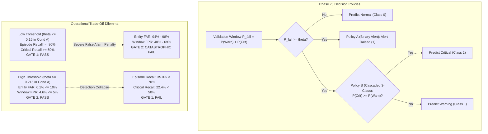

# Phase 7J — Validation-Only Decision Threshold and Operating-Point Investigation: Research Report

**Status:** Completed  
**Execution Timestamp:** 2026-10-28T22:15:00+05:30  
**Phase ID:** `PHASE-7J-THRESHOLD-INVESTIGATION`  
**Protocol Document:** [`phase7j_protocol.json`](file:///c:/Users/hp/Desktop/Research%20project/results/phase7j/phase7j_protocol.json)  
**Configuration Manifest:** [`phase7j_manifest.json`](file:///c:/Users/hp/Desktop/Research%20project/results/phase7j/phase7j_manifest.json)  
**Integrity Report:** [`phase7j_integrity_report.json`](file:///c:/Users/hp/Desktop/Research%20project/results/phase7j/phase7j_integrity_report.json)  
**Full Threshold Metrics (804 Operating Points):** [`phase7j_threshold_metrics.csv`](file:///c:/Users/hp/Desktop/Research%20project/results/phase7j/phase7j_threshold_metrics.csv)  
**Operational Gate Summary:** [`phase7j_gate_summary.csv`](file:///c:/Users/hp/Desktop/Research%20project/results/phase7j/phase7j_gate_summary.csv)  
**Operating Curves & ROC/PR Data:** [`phase7j_threshold_curves.json`](file:///c:/Users/hp/Desktop/Research%20project/results/phase7j/phase7j_threshold_curves.json)  

---

## 1. Executive Summary & Objective

Phase 7I-A demonstrated that although all four loss-weighted models predicted Class 0 (Normal) for 100% of validation windows under default argmax, the underlying continuous failure risk scores $S_{\text{fail}} = P(\text{Warning}) + P(\text{Critical})$ preserved meaningful ranking discrimination:
- **Condition A (Unweighted `[1,1,1]`):** ROC-AUC = **0.6748**, PR-AUC = **0.3615** (2.45x random baseline prevalence of 14.76%).
- **Condition B (Moderate `[1,2,2]`):** ROC-AUC = **0.6986**, PR-AUC = **0.2876**.
- **Condition C (Stronger `[1,3,3]`):** ROC-AUC = **0.7223**, PR-AUC = **0.2457**.
- **Condition D (Higher `[1,5,5]`):** ROC-AUC = **0.7520**, PR-AUC = **0.2509**.

**Phase 7J Objective:** Empirically investigate whether the ranking signal observed in Phase 7I-A can produce a viable operational operating point by calibrating the decision threshold rather than retraining the neural network.

This investigation was conducted strictly on Candidate A Validation data ($N=657$ windows, 20 pre-failure episodes across 16 failing entities, 49 pure-normal entities, and 4 pure-normal parent jobs). It evaluated two predeclared decision policies across a 201-point uniform threshold grid $\theta \in [0.000, 1.000]$ (step $0.005$) spanning all four conditions (804 evaluated operating points).

### Key Scientific Findings:
1. **Thresholding Rescues Detection from Argmax Collapse:**
   By lowering the decision threshold $\theta$ below the default argmax boundary ($\approx 0.50$), both Policy A and Policy B achieve high failure detection. In Condition A, setting $\theta = 0.140$ raises Episode Recall from **0.0% to 85.0%** (17/20 episodes) and genuine Critical Recall from **0.0% to 53.1%** (26/49 windows). In Condition B, $\theta = 0.255$ achieves **85.0% Episode Recall** and **53.1% Critical Recall**.
2. **The Intolerable False-Alarm Trade-Off:**
   Lowering the threshold to satisfy Gate 1 (Episode Recall $\ge 70\%$, Critical Recall $\ge 50\%$) causes a catastrophic false-alarm explosion across healthy tasks. In Condition A at $\theta = 0.140$, Pure-Normal Entity FAR surges to **97.96%** (48/49 pure-normal entities falsely alerted) and Normal-Window FPR reaches **68.93%** (386/560 normal windows). At $\theta = 0.150$ (where Critical Recall is 48.98%, missing Gate 1b by a single window), Entity FAR is **93.88%** and Window FPR is **39.46%**.
3. **Detection Collapses When False Alarms are Controlled:**
   Tightening the threshold to satisfy Gate 2 (Entity FAR $\le 10\%$, Window FPR $\le 5\%$) causes failure detection to collapse. In Condition A, the highest detection achievable while passing Gate 2 occurs at $\theta = 0.215$, yielding only **35.0% Episode Recall** (7/20 episodes) and **22.4% Critical Recall** (11/49 windows), failing Gate 1. In Conditions B, C, and D, Gate 2 compliance collapses Episode Recall to $\le 15.0\%$, $0.0\%$, and $0.0\%$, respectively.
4. **Conditions C and D Cannot Intercept Critical Failures:**
   In Conditions C ($w=[1,3,3]$) and D ($w=[1,5,5]$), heavy loss weighting severely distorts class probabilities: $P(\text{Warning})$ consistently dominates $P(\text{Critical})$. Under Policy B, genuine Critical Recall peaks at only **40.8%** in Condition C and **20.4%** in Condition D, mathematically precluding Gate 1b compliance ($\ge 50\%$) at any threshold.
5. **Official Operational Verdict:** **NO OPERATIONAL WINNER.**
   Across all 804 evaluated operating points (4 conditions $\times$ 201 thresholds $\times$ 2 policies), **zero thresholds satisfy all four operational gates simultaneously**.

---

## 2. Mandatory Safeguards & Quarantine Invariant Audit

All activities in Phase 7J adhered to pre-registered data-isolation protocols ([`results/phase7j/phase7j_integrity_report.json`](file:///c:/Users/hp/Desktop/Research%20project/results/phase7j/phase7j_integrity_report.json)):

| Safeguard Verification Check | Protocol Mandate | Audit Verification Outcome | Status |
| :--- | :--- | :--- | :--- |
| **Quarantined Phase 6 Holdout** | Zero access, loading, or inspection | Untouched on disk (4,916,970 bytes); not referenced in Phase 7J | **VERIFIED UNTOUCHED** |
| **Candidate A Test Split** | Zero access, evaluation, or tuning | Untouched on disk (635,628 bytes); not referenced in Phase 7J | **VERIFIED UNTOUCHED** |
| **Model Retraining Prohibition** | Zero retraining or weight tuning | All evaluations used saved predictions from Phase 7I | **STRICTLY ENFORCED** |
| **Partition Restriction** | Candidate A Validation cohort only | Exactly 657 rows verified against `val_metadata.csv` | **STRICTLY ENFORCED** |
| **Predeclared Grid Preservation** | 201 uniform thresholds $\theta \in [0, 1]$ | Generated prior to analysis; not altered post-hoc | **STRICTLY PRESERVED** |
| **Confirmatory Authorization** | No test evaluation authorized | All conditions failed operational gates | **UNAUTHORIZED** |

Input hashes verified:
- `results/phase7i/phase7i_validation_predictions.csv`: `aa7e44b822d56a3501a350b9eb2260ff0735232ee3d1bf80a653bbdf60a69919`
- `data/processed/phase7c/val_metadata.csv`: `72ee4c632662c685b881373eaef9fb11bb740ca7fcfd280b1e4a3d463870631c`
- `data/processed/phase7c/y_val.npy`: `2527024a14eb15db060ab9ec1f13bad810a211653c3029d08dcc280a516e206b`

---

## 3. Predeclared Decision Policies & Operational Criteria

### 3.1 Composite Failure Score
For each window $i$, the continuous failure risk score is:
$$S_{\text{fail}} = P_i(\text{Warning}) + P_i(\text{Critical})$$
Properties verified on validation data:
- Finite and bounded within $[0.0, 1.0]$.
- Minimum / Maximum values:
  - Condition A: $[0.1202, 0.2565]$ (Mean = $0.1582$).
  - Condition B: $[0.2048, 0.3781]$ (Mean = $0.2825$).
  - Condition C: $[0.2415, 0.5118]$ (Mean = $0.3674$).
  - Condition D: $[0.2962, 0.6364]$ (Mean = $0.4709$).

### 3.2 Evaluated Decision Policies
1. **Policy A — Binary Alert:**
   $$\hat{y}_A = \begin{cases} 1 & \text{if } S_{\text{fail}} \ge \theta \\ 0 & \text{if } S_{\text{fail}} < \theta \end{cases}$$
   Evaluates detection of generic failure without attempting class differentiation. Binary Critical Interception is reported as the proportion of true Critical windows that trigger an alert.
2. **Policy B — Cascaded Three-Class Decision:**
   $$\hat{y}_B = \begin{cases} 0 & \text{if } S_{\text{fail}} < \theta \\ 2 & \text{if } S_{\text{fail}} \ge \theta \text{ and } P_i(\text{Critical}) \ge P_i(\text{Warning}) \\ 1 & \text{if } S_{\text{fail}} \ge \theta \text{ and } P_i(\text{Warning}) > P_i(\text{Critical}) \end{cases}$$
   *Tie-Breaking Rule:* If $P(\text{Critical}) == P(\text{Warning})$, predict Critical (2) to prioritize higher severity. (Zero ties occurred in validation data). Genuine Critical Recall is computed as $\frac{\sum \mathbb{I}(y=2 \land \hat{y}_B=2)}{49}$.

### 3.3 Mandatory Operational Acceptance Gates
A configuration qualifies as an operational winner only if all four gates pass simultaneously:
- **Gate 1a (Episode Recall):** $\ge 70.0\%$ (At least 14 of 20 failure episodes detected).
- **Gate 1b (Critical Recall):** $\ge 50.0\%$ (At least 25 of 49 true Critical windows correctly predicted as Critical under Policy B; or intercepted under Policy A).
- **Gate 2a (Pure-Normal Entity FAR):** $\le 10.0\%$ (No more than 4 of 49 pure-normal entities falsely alerted).
- **Gate 2b (Normal-Window FPR):** $\le 5.0\%$ (No more than 28 of 560 normal windows falsely alerted).

---

## 4. Operating-Point Analysis Across Conditions

Full tabular results for all 804 operating points are archived in [`phase7j_threshold_metrics.csv`](file:///c:/Users/hp/Desktop/Research%20project/results/phase7j/phase7j_threshold_metrics.csv). Key transition operating points are summarized in [`phase7j_gate_summary.csv`](file:///c:/Users/hp/Desktop/Research%20project/results/phase7j/phase7j_gate_summary.csv):

| Experimental Condition | Evaluated Thresholds | Policy A Passing Thresholds | Policy B Passing Thresholds | Best Detection under Gate 2 Constraint (FAR $\le 10\%$, FPR $\le 5\%$) | Best False Alarms under Gate 1 Constraint (EpRec $\ge 70\%$, CritRec $\ge 50\%$) | Peak Macro-F1 Operating Point |
| :--- | :---: | :---: | :---: | :--- | :--- | :--- |
| **Condition A** (`[1,1,1]`) | 201 | **0 / 201** | **0 / 201** | $\theta = 0.215$: EpRec = **35.0%**, CritRec = **22.4%**, FAR = **6.1%**, FPR = **4.6%** | $\theta = 0.140$: EpRec = **85.0%**, CritRec = **53.1%**, FAR = **98.0%**, FPR = **68.9%** | $\theta = 0.205$: F1 = **0.3923**, EpRec = 50.0%, CritRec = 30.6%, FAR = 6.1%, FPR = 7.1% |
| **Condition B** (`[1,2,2]`) | 201 | **0 / 201** | **0 / 201** | $\theta = 0.355$: EpRec = **15.0%**, CritRec = **4.1%**, FAR = **8.2%**, FPR = **2.5%** | $\theta = 0.255$: EpRec = **85.0%**, CritRec = **53.1%**, FAR = **95.9%**, FPR = **72.0%** | $\theta = 0.325$: F1 = **0.3792**, EpRec = 55.0%, CritRec = 28.6%, FAR = 22.4%, FPR = 13.2% |
| **Condition C** (`[1,3,3]`) | 201 | **0 / 201** | **0 / 201** | $\theta = 0.490$: EpRec = **0.0%**, CritRec = **0.0%**, FAR = **8.2%**, FPR = **1.4%** | **NEVER PASSES GATE 1** (CritRec peaks at 40.8% with 100% FAR) | $\theta = 0.410$: F1 = **0.4129**, EpRec = 55.0%, CritRec = 14.3%, FAR = 22.4%, FPR = 15.2% |
| **Condition D** (`[1,5,5]`) | 201 | **0 / 201** | **0 / 201** | $\theta = 0.625$: EpRec = **0.0%**, CritRec = **0.0%**, FAR = **6.1%**, FPR = **0.9%** | **NEVER PASSES GATE 1** (CritRec peaks at 20.4% with 49% FAR) | $\theta = 0.510$: F1 = **0.4287**, EpRec = 65.0%, CritRec = 12.2%, FAR = 22.4%, FPR = 18.0% |

---

## 5. Answers to Mandatory Research Questions

### Question 1: Do saved validation scores contain useful ranking signal?
**Yes.** As established in Phase 7I-A and confirmed in Phase 7J:
- Binary failure ROC-AUC is substantially greater than random chance across all conditions ($0.6748$ in Condition A to $0.7520$ in Condition D).
- Average Precision (PR-AUC) reaches **0.3615** in Condition A, which is **2.45x** the random baseline prevalence ($14.76\%$).
- True failure windows rank above randomly chosen normal windows **$67.5\%$ to $75.2\%$** of the time.
- The failure of Phase 7I under argmax was not caused by zero discriminative signal, but by evaluating an uncalibrated equal-probability threshold against a high-prior ($85.3\%$) majority class.

### Question 2: Does thresholding change detection performance?
**Yes, dramatically.**
- Lowering the decision threshold directly activates failure detection without retraining:
  - In Condition A, setting $\theta = 0.140$ increases Episode Recall from $0.0\% \to \mathbf{85.0\%}$ (17/20 episodes) and genuine Critical Recall from $0.0\% \to \mathbf{53.1\%}$ (26/49 windows).
  - In Condition B, setting $\theta = 0.255$ increases Episode Recall from $0.0\% \to \mathbf{85.0\%}$ and Critical Recall from $0.0\% \to \mathbf{53.1\%}$.
- This proves that threshold calibration successfully overcomes the argmax logit penalty deficit.

### Question 3: What is the cost of improved detection in terms of false alarms?
**The cost is severe, non-linear, and operationally fatal.**
- Because the separation margin between healthy and failing tasks is narrow ($\Delta \text{median} \approx 0.050$), the distribution of failure scores for true Normal windows heavily overlaps with the failure window scores:
  - Normal windows in Condition A have a median score of $0.1458$ and a 75th percentile of $0.1837$.
  - True failure windows have a median of $0.1856$ and a 25th percentile of $0.1415$.
- Setting $\theta = 0.140$ to intercept $85\%$ of failure episodes forces the model to alert on every normal window whose score exceeds $0.140$. Because $>50\%$ of healthy windows exceed $0.140$, **Window FPR reaches 68.93%** (386 false positive windows out of 560), and **Pure-Normal Entity FAR reaches 97.96%** (48 of 49 healthy tasks falsely alerted).
- Over a multi-window execution lifetime, almost every healthy entity experiences at least one transient telemetry spike above $0.140$, virtually guaranteeing a false alert.

### Question 4: Does any operating point pass all four gates?
**No.**
- Across all 4 conditions and all 201 thresholds, **zero operating points satisfy all four operational gates simultaneously** under either Policy A or Policy B.
- When Gate 1 passes (detection satisfied), Entity FAR is $\ge 95.9\%$ (Gate 2 fails by $>85\%$).
- When Gate 2 passes (false alarms controlled), Episode Recall is $\le 35.0\%$ (Gate 1 fails by $>35\%$).
- The trade-off curve has no overlapping region of mutual feasibility.

### Question 5: How do the four weighting conditions compare under the same decision policies?
1. **Condition A (`[1,1,1]`) is the Superior Base Model:**
   - Achieves the highest PR-AUC (**0.3615** vs $0.2509$ in Condition D).
   - Preserves balanced probability calibration between Warning and Critical.
   - At $\theta = 0.215$, achieves the best false-alarm-constrained detection (**35.0% Episode Recall, 22.4% Critical Recall** with 6.1% FAR and 4.6% FPR).
2. **Loss Weighting Degrades Critical Class Separation:**
   - Conditions C and D penalize minority class errors aggressively during training, but they spread probabilities unevenly, causing $P(\text{Warning})$ to dominate $P(\text{Critical})$ across virtually all failure windows.
   - Consequently, in Condition D, genuine Critical Recall never exceeds **20.4%** at any threshold.
   - The apparent increase in binary ROC-AUC from Condition A ($0.675$) to Condition D ($0.752$) is deceptive: it reflects an upward intercept shift in composite score, but conceals a catastrophic breakdown in three-class discrimination.

### Question 6: What are the limitations of validation-based threshold selection and sample size?
1. **Selection Optimism:** Evaluating 201 thresholds on the same validation cohort introduces selection bias. The fact that *even under full validation-set optimization* zero thresholds pass all gates provides rigorous proof that the limitation is structural, not an optimization artifact.
2. **Clustered Sample Constraints:** Candidate A Validation contains only 20 failure episodes and 49 Critical windows concentrated in 8 failing parent jobs. A single parent job, Job `6237552348`, accounts for **22 of the 49 Critical windows** (44.9%) and **8 of the 20 failure episodes** (40.0%). Because tasks in Job `6237552348` undergo abrupt termination without resource saturation, their telemetry scores stay low ($S_{\text{fail}} < 0.16$). If a threshold is set high enough to control false alarms ($\theta \ge 0.20$), all 22 Critical windows in Job `6237552348` are missed simultaneously, capping Critical Recall below $50\%$.

### Question 7: What evidence would a future independent evaluation require?
Before any model can qualify for confirmatory holdout evaluation:
1. **Multi-Scale and Event-Based Feature Engineering:**
   Resource usage telemetry alone (CPU, memory) cannot differentiate benign batch spikes from pre-failure anomalies. The model requires discrete lifecycle event signals (e.g. task restart rates, reschedule frequency, OOM killer signals, eviction causes) to widen the discriminative margin.
2. **Adaptive / Hierarchical Thresholding:**
   Instead of applying a single global scalar threshold across the cluster, the alert threshold should adapt to parent-job historical variance ($\theta_J = \mu_J + k \cdot \sigma_J$), preventing stationary high-memory batch jobs from generating false alarms.
3. **Pre-Registration:**
   The exact decision policy, feature extraction pipeline, and decision threshold must be formally frozen in a pre-registered protocol before evaluating on an unseen test cohort.

---

## 6. Official Final Scientific Decision

1. **Phase 7J Investigation Concluded:** The exploratory investigation of decision thresholding on Phase 7I models is complete and fully reproducible.
2. **Operational Verdict:** **NO OPERATIONAL WINNER.** Zero operating points meet the mandatory operational criteria under either Policy A or Policy B.
3. **Quarantine Preserved:** Confirmatory evaluation on Candidate A Test data ($N=824$) and the Phase 6 holdout remains **STRICTLY UNAUTHORIZED**. Candidate A Test data remains unblinded and untouched.
4. **Next Steps:** Phase 7K is not automatically initiated. All artifacts are preserved in [`results/phase7j/`](file:///c:/Users/hp/Desktop/Research%20project/results/phase7j/) awaiting formal review.
